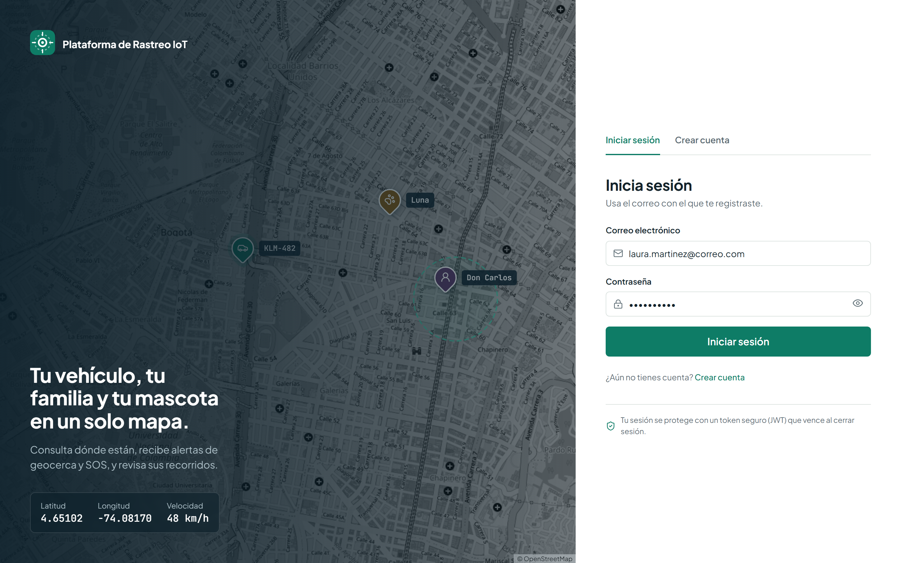
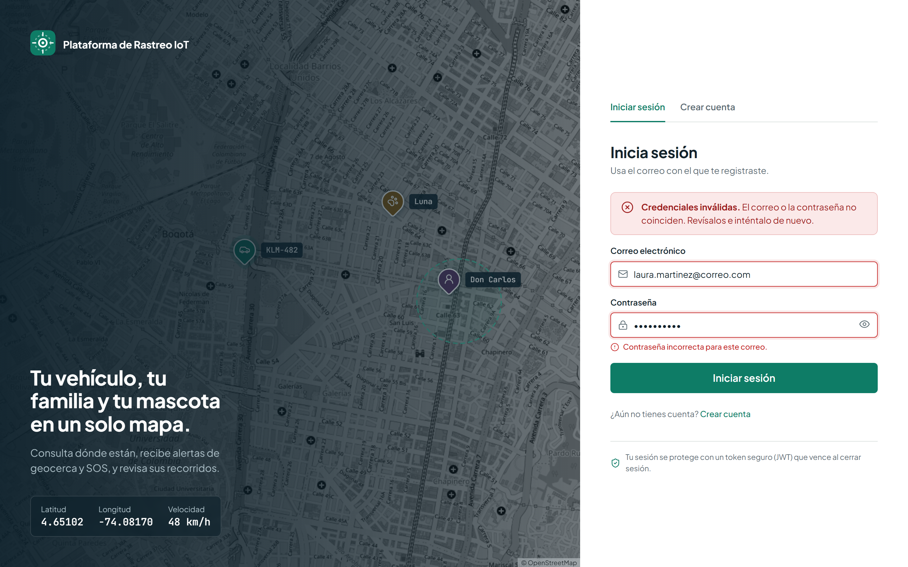
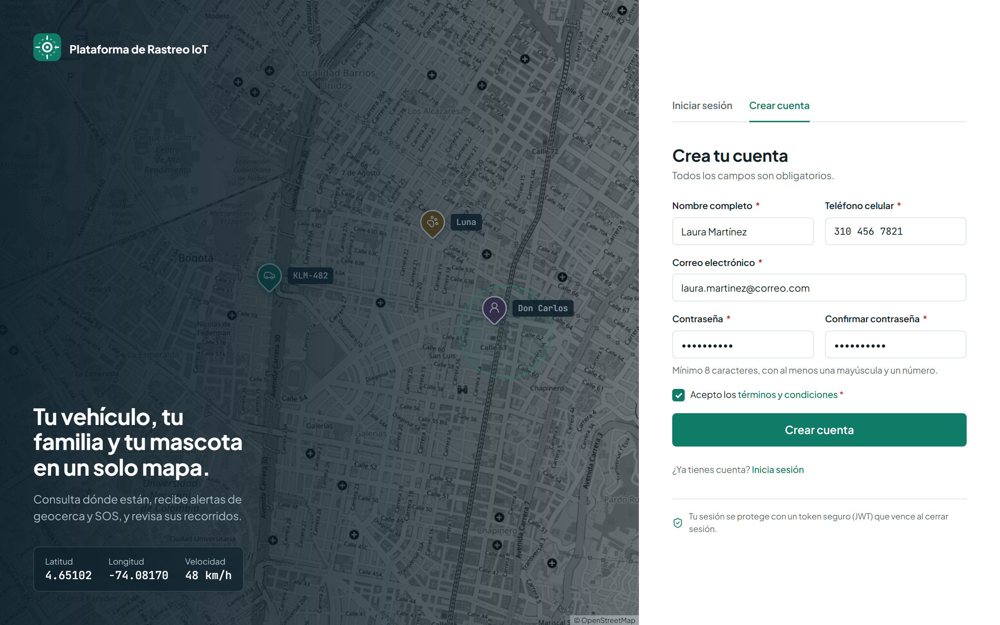
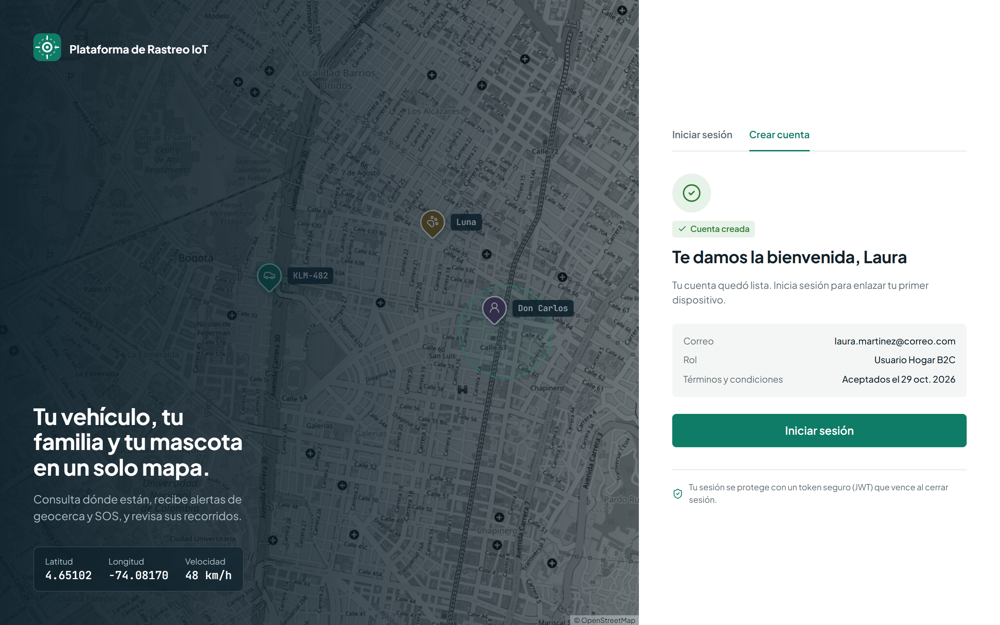

### HU-01: Registro e inicio de sesión seguro

**Como** usuario B2C o administrador B2B
**Quiero** registrarme e iniciar sesión de forma segura mediante JWT
**Para** acceder al sistema con autenticación protegida y usar la plataforma de forma confiable

**Validación INVEST**
- I — Independent: ✅ Se puede desarrollar de forma independiente porque define la autenticación y acceso inicial del sistema.
- N — Negotiable: ✅ Describe el objetivo y la necesidad sin imponer una implementación técnica específica.
- V — Valuable: ✅ Aporta valor porque permite acceso seguro y controlado a la aplicación.
- E — Estimable: ✅ Tiene suficiente contexto para estimar el esfuerzo de diseño, backend y validaciones.
- S — Small: ✅ Es una historia acotada al flujo de registro e inicio de sesión.
- T — Testable: ✅ Puede validarse con escenarios de registro exitoso, credenciales inválidas y sesiones vencidas.

**Gherkin**
```gherkin
# language: es
Característica: Registro e inicio de sesión seguro

  Escenario: Registro exitoso de un usuario B2C
    Dado que un usuario nuevo completa sus datos obligatorios
    Y acepta los términos y condiciones
    Cuando se envía el formulario de registro
    Entonces el sistema crea la cuenta del usuario
    Y genera una credencial segura para el acceso posterior

  Escenario: Inicio de sesión con credenciales válidas
    Dado que un usuario registrado existe en el sistema
    Cuando ingresa su correo y contraseña válidos
    Entonces el sistema valida las credenciales
    Y devuelve un token JWT válido para acceder a la aplicación

  Escenario: Inicio de sesión con credenciales inválidas
    Dado que un usuario intenta iniciar sesión con una contraseña incorrecta
    Cuando el sistema valida las credenciales
    Entonces rechaza el acceso
    Y muestra un mensaje de error claro
```

**Supuestos / preguntas abiertas**
- Se asume autenticación mediante JWT para usuarios B2C y administradores B2B.
- Se asume que las credenciales se validan con políticas mínimas de seguridad y manejo de errores.
- No quedan preguntas abiertas bloqueantes tras la clarificación recibida.

## Mockups


*Figura: Formulario de inicio de sesión con correo y contraseña, junto al panel de marca con el mapa de Bogotá.*


*Figura: Acceso rechazado con el mensaje "Credenciales inválidas" y los campos marcados en rojo.*


*Figura: Formulario de registro con los datos obligatorios y la aceptación de términos y condiciones.*


*Figura: Cuenta creada para un Usuario Hogar B2C, lista para iniciar sesión.*
