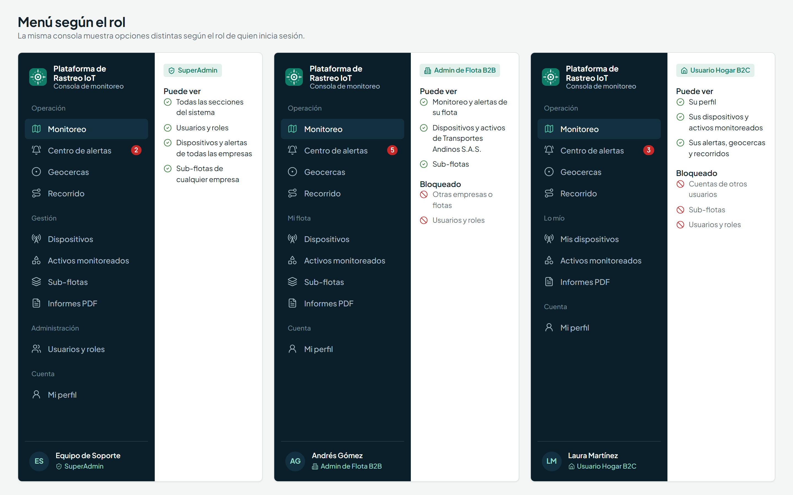
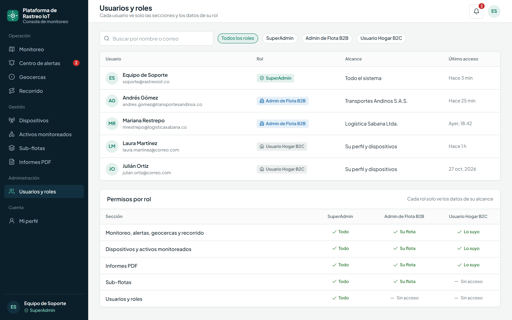
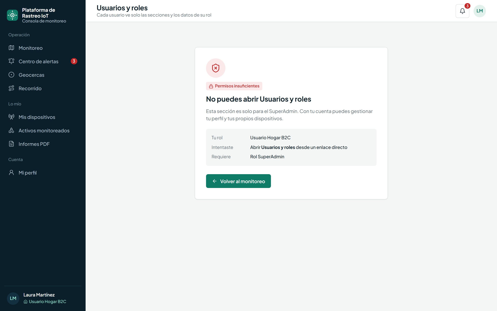

### HU-02: Gestión de permisos por rol

**Como** usuario del sistema
**Quiero** acceder solo a las vistas y acciones permitidas para mi rol
**Para** mantener un control de acceso seguro y ordenado según mi perfil

**Validación INVEST**
- I — Independent: ✅ Se puede desarrollar de forma independiente porque define la base del control de acceso.
- N — Negotiable: ✅ El alcance de permisos se puede ajustar en el detalle sin cambiar la necesidad de negocio.
- V — Valuable: ✅ Aporta valor porque evita accesos indebidos y mejora seguridad.
- E — Estimable: ✅ El comportamiento por rol es claro y se puede estimar con base en los roles definidos.
- S — Small: ✅ La historia es concreta y limitada al control de permisos por rol.
- T — Testable: ✅ Puede verificarse con escenarios de acceso permitido y denegado por cada rol.

**Gherkin**
```gherkin
# language: es
Característica: Gestión de permisos por rol

  Escenario: SuperAdmin accede a todas las vistas y acciones
    Dado que un usuario tiene el rol SuperAdmin
    Cuando intenta acceder a cualquier sección del sistema
    Entonces el sistema le permite el acceso
    Y no bloquea acciones administrativas relevantes

  Escenario: Admin de Flota B2B accede solo a su empresa y flota
    Dado que un usuario tiene el rol Admin de Flota B2B
    Cuando intenta acceder a las funciones de su empresa o flota
    Entonces el sistema le permite el acceso
    Y restringe el acceso a otras empresas o flotas no asignadas

  Escenario: Usuario Hogar B2C accede solo a su perfil y dispositivos
    Dado que un usuario tiene el rol Usuario Hogar B2C
    Cuando intenta acceder a otras cuentas o recursos ajenos
    Entonces el sistema bloquea el acceso
    Y muestra un mensaje de permisos insuficientes
```

**Supuestos / preguntas abiertas**
- Se asume que SuperAdmin tiene alcance total, Admin de Flota B2B solo sobre su empresa/flota y Usuario Hogar B2C solo sobre su propio perfil y dispositivos.
- Se asume que el control es por rol y por pertenencia a entidad/empresa, no por permisos granulares adicionales.
- No quedan preguntas abiertas bloqueantes tras la clarificación recibida.

## Mockups


*Figura: Barra lateral de cada rol: SuperAdmin, Admin de Flota B2B y Usuario Hogar B2C, con lo que puede ver y lo que tiene bloqueado.*


*Figura: Vista del SuperAdmin con los usuarios, su rol, su alcance y la matriz de permisos por rol.*


*Figura: Un Usuario Hogar B2C intenta abrir Usuarios y roles y el sistema bloquea el acceso con el mensaje de permisos insuficientes.*
