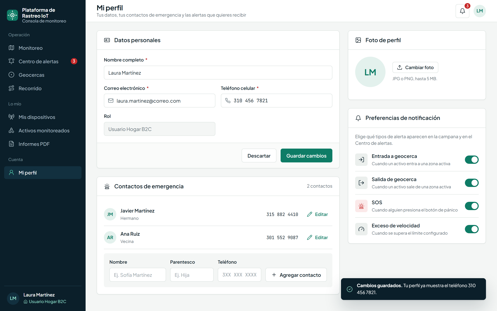
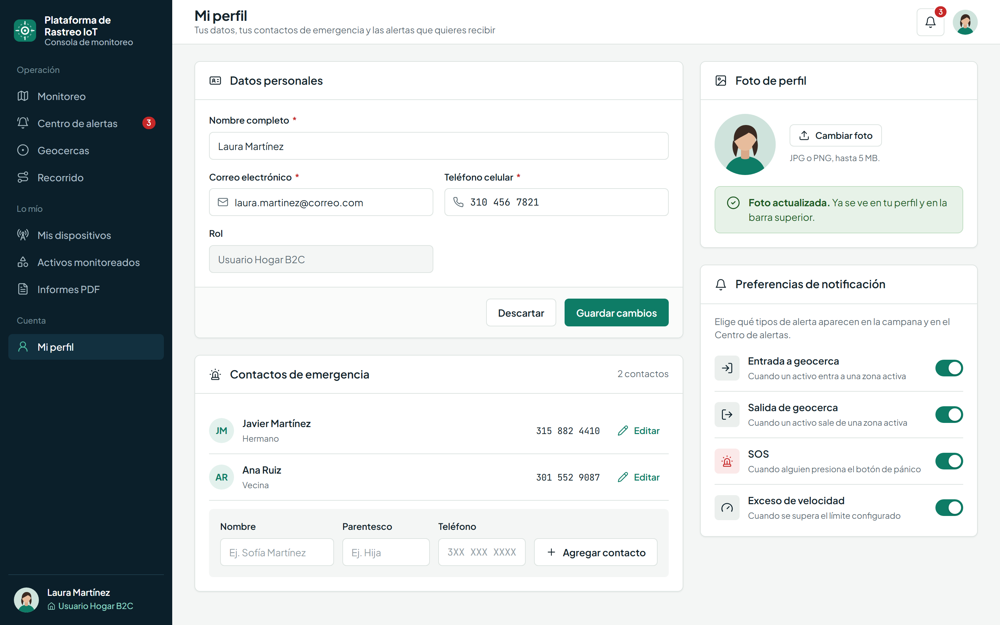
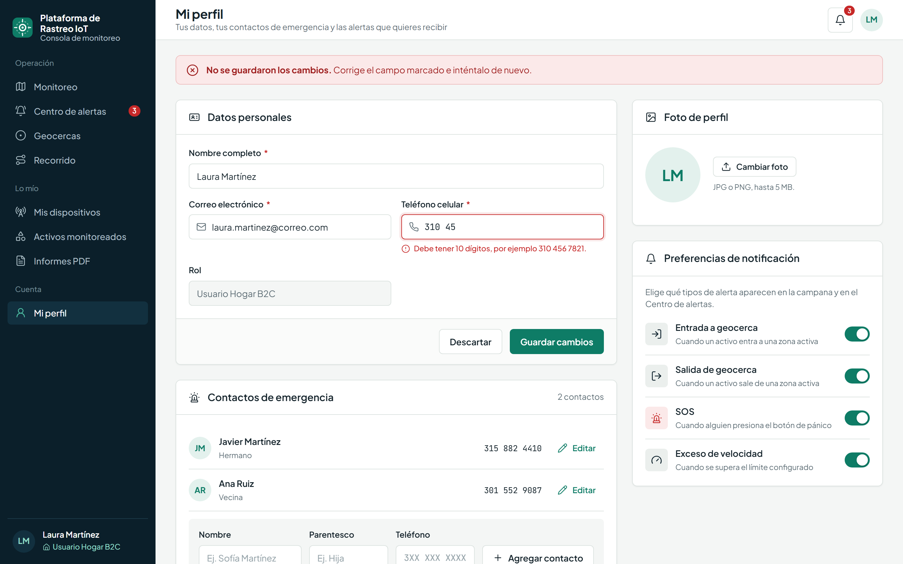

### HU-03: Actualización de datos personales y preferencias

**Como** usuario autenticado
**Quiero** actualizar mis datos personales, foto de perfil, contactos de emergencia y preferencias de notificación
**Para** mantener mi información actualizada y ajustar cómo recibo alertas y comunicaciones

**Validación INVEST**
- I — Independent: ✅ Puede desarrollarse por separado de otras historias, siempre que exista un perfil de usuario y autenticación.
- N — Negotiable: ✅ La forma de edición puede ajustarse según el diseño final, pero la necesidad de negocio es clara.
- V — Valuable: ✅ Aporta valor porque mejora la calidad y utilidad del perfil del usuario.
- E — Estimable: ✅ La funcionalidad tiene una estructura clara de datos y validaciones.
- S — Small: ✅ Es una unidad de trabajo delimitada a la gestión del perfil del usuario.
- T — Testable: ✅ Puede validarse con escenarios de actualización exitosa y errores de validación.

**Gherkin**
```gherkin
# language: es
Característica: Actualización de datos personales y preferencias

  Escenario: Usuario actualiza sus datos personales
    Dado que un usuario autenticado existe en el sistema
    Cuando modifica sus datos personales válidos
    Entonces el sistema guarda la nueva información
    Y refleja los cambios en su perfil

  Escenario: Usuario actualiza su foto de perfil
    Dado que un usuario autenticado tiene acceso a su perfil
    Cuando carga una imagen válida
    Entonces el sistema guarda la foto
    Y la muestra en la interfaz del perfil

  Escenario: Usuario intenta guardar información inválida
    Dado que un usuario autenticado está editando su perfil
    Cuando ingresa datos inválidos o incompletos
    Entonces el sistema rechaza la actualización
    Y muestra un mensaje de validación claro
```

**Supuestos / preguntas abiertas**
- Se asume que las preferencias de notificación pueden configurarse por tipo de alerta o canal.
- Se asume que los contactos de emergencia se almacenan como parte del perfil del usuario.
- No quedan preguntas abiertas bloqueantes tras la clarificación recibida.

## Mockups


*Figura: Datos personales, contactos de emergencia, foto de perfil y preferencias de notificación por tipo de alerta, con el aviso de cambios guardados.*


*Figura: La foto cargada se muestra en el perfil y en la barra superior.*


*Figura: El sistema rechaza la actualización y marca el teléfono con un mensaje de validación claro.*
