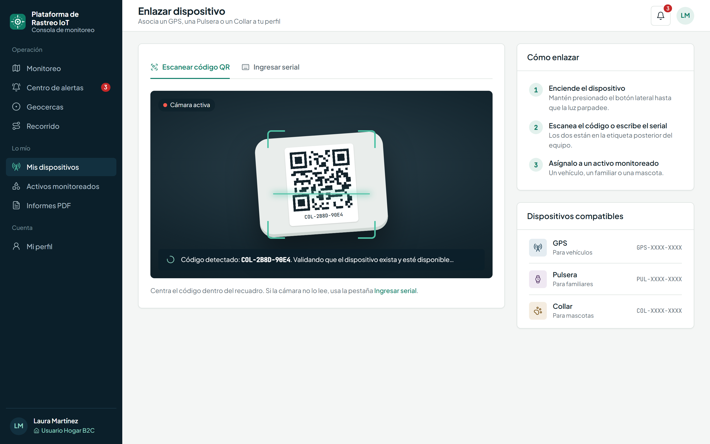
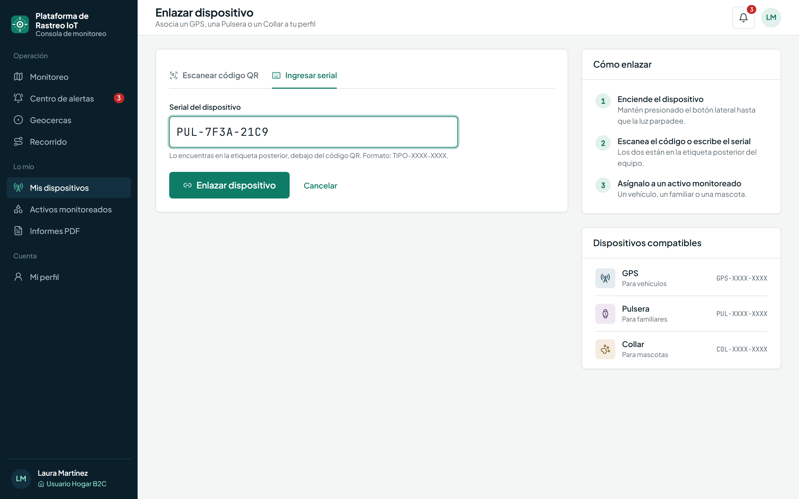
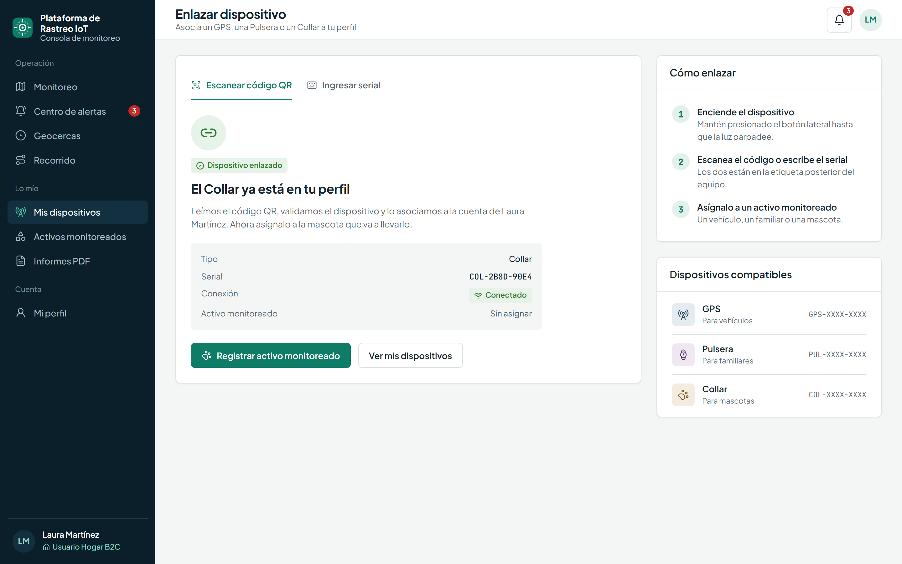
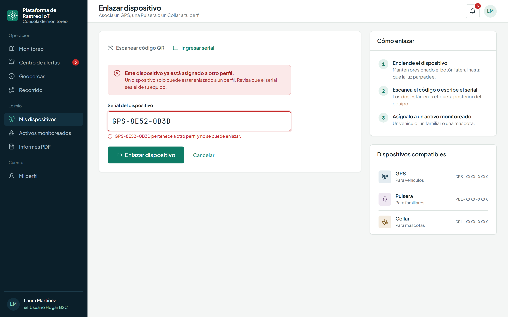

### HU-04: Enlace de dispositivos por QR o serial

**Como** usuario autenticado
**Quiero** enlazar dispositivos GPS, pulseras y collares a mi perfil mediante QR o serial único
**Para** asociar los dispositivos de monitoreo que deseo administrar

**Validación INVEST**
- I — Independent: ✅ Puede desarrollarse de forma independiente si ya existe el perfil de usuario y el catálogo de dispositivos.
- N — Negotiable: ✅ El mecanismo de enlace puede adaptarse sin cambiar la necesidad de negocio.
- V — Valuable: ✅ Aporta valor porque permite asociar dispositivos al perfil del usuario para su administración.
- E — Estimable: ✅ El flujo es claro y se puede estimar con base en validaciones y asociaciones.
- S — Small: ✅ Es una historia acotada al proceso de vinculación de dispositivos.
- T — Testable: ✅ Puede validarse con escenarios de enlace exitoso y de dispositivo ya asignado.

**Gherkin**
```gherkin
# language: es
Característica: Enlace de dispositivos por QR o serial

  Escenario: Enlace exitoso de un dispositivo mediante QR
    Dado que un usuario autenticado tiene un dispositivo disponible
    Cuando escanea el código QR del dispositivo
    Entonces el sistema valida el código
    Y asocia el dispositivo al perfil del usuario

  Escenario: Enlace exitoso de un dispositivo mediante serial único
    Dado que un usuario autenticado conoce el serial del dispositivo
    Cuando ingresa el serial en el sistema
    Entonces el sistema valida la existencia del dispositivo
    Y lo enlaza correctamente al perfil del usuario

  Escenario: Intento de enlazar un dispositivo ya asignado
    Dado que un dispositivo ya está asociado a otro perfil
    Cuando un usuario intenta enlazarlo nuevamente
    Entonces el sistema rechaza la operación
    Y muestra un mensaje de dispositivo ya asignado
```

**Supuestos / preguntas abiertas**
- Se asume que el sistema valida que un dispositivo no esté ya asignado a otro perfil antes de enlazarlo.
- Se asume que los dispositivos pueden ser GPS, pulseras o collares según el catálogo del sistema.
- No quedan preguntas abiertas bloqueantes tras la clarificación recibida.

## Mockups


*Figura: Pestaña "Escanear código QR" con el marco de cámara validando el Collar COL-2B8D-90E4.*


*Figura: Pestaña "Ingresar serial" con el serial PUL-7F3A-21C9.*


*Figura: El dispositivo queda asociado al perfil del usuario y se sugiere asignarlo a un activo monitoreado.*


*Figura: Error "Este dispositivo ya está asignado a otro perfil".*
