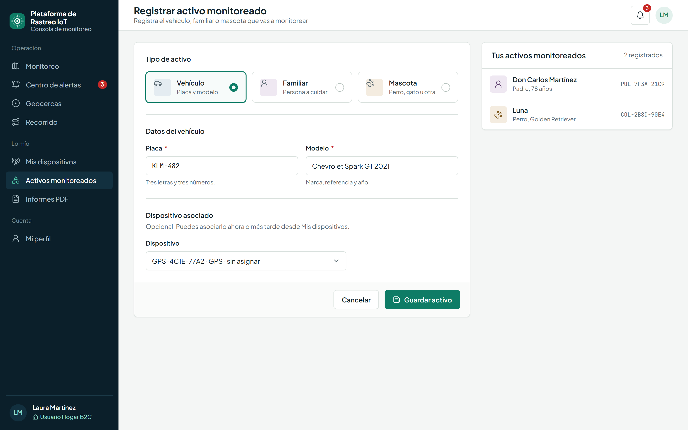
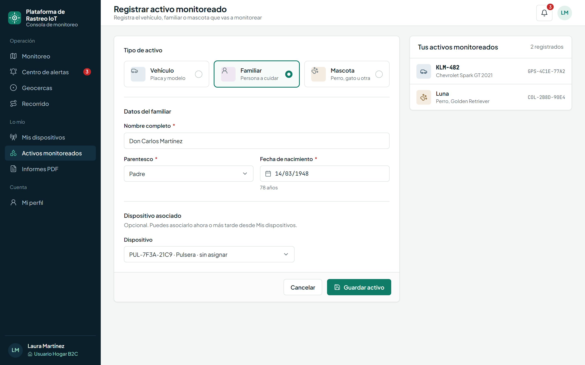
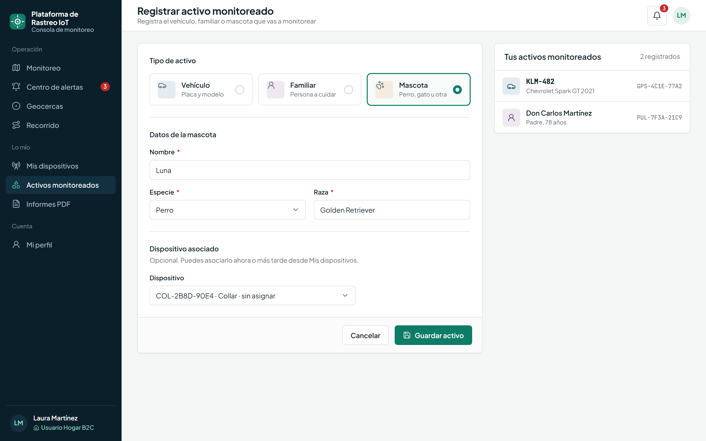
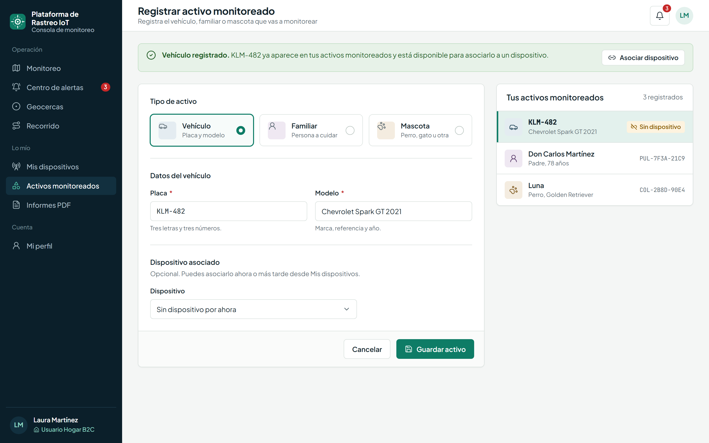
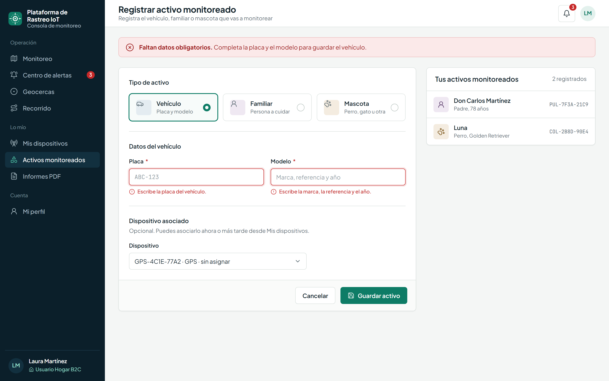

### HU-05: Registro del activo o sujeto monitoreado

**Como** usuario autenticado
**Quiero** registrar la información básica del activo o sujeto monitoreado
**Para** identificar y administrar correctamente cada vehículo, familiar o mascota asociada al perfil

**Validación INVEST**
- I — Independent: ✅ Puede desarrollarse como un módulo de datos básicos independiente.
- N — Negotiable: ✅ El contenido exacto de los campos puede ajustarse, pero la necesidad de registro es clara.
- V — Valuable: ✅ Aporta valor al permitir relacionar los datos del activo con el dispositivo y el usuario.
- E — Estimable: ✅ Tiene una estructura de datos clara y un alcance acotado.
- S — Small: ✅ Es una historia de registro de información básica.
- T — Testable: ✅ Se puede verificar con creación válida, edición y validación de campos obligatorios.

**Gherkin**
```gherkin
# language: es
Característica: Registro del activo o sujeto monitoreado

  Escenario: Registro exitoso de un vehículo
    Dado que un usuario autenticado desea registrar un vehículo
    Cuando ingresa la placa y el modelo del vehículo
    Entonces el sistema guarda la información del activo
    Y lo deja disponible para asociación con un dispositivo

  Escenario: Registro exitoso de un familiar
    Dado que un usuario autenticado desea registrar a un familiar
    Cuando ingresa los datos básicos del familiar
    Entonces el sistema guarda los datos del sujeto monitoreado
    Y lo muestra en el perfil asociado

  Escenario: Registro con datos incompletos
    Dado que un usuario autenticado intenta guardar un registro sin información mínima requerida
    Cuando el sistema valida el formulario
    Entonces rechaza el registro
    Y muestra un mensaje de datos obligatorios faltantes
```

**Supuestos / preguntas abiertas**
- Se asume que el sistema puede manejar simultáneamente vehículos, familiares y mascotas, con datos específicos para cada tipo.
- Se asume que los campos mínimos varían según el tipo de entidad monitorizada.
- No quedan preguntas abiertas bloqueantes tras la clarificación recibida.

## Mockups


*Figura: Tipo Vehículo con placa y modelo, y opción de asociarlo a un dispositivo.*


*Figura: Tipo Familiar con nombre, parentesco y fecha de nacimiento.*


*Figura: Tipo Mascota con nombre, especie y raza.*


*Figura: El vehículo KLM-482 queda registrado y disponible para asociarse a un dispositivo.*


*Figura: El sistema rechaza el registro y marca la placa y el modelo como obligatorios.*
