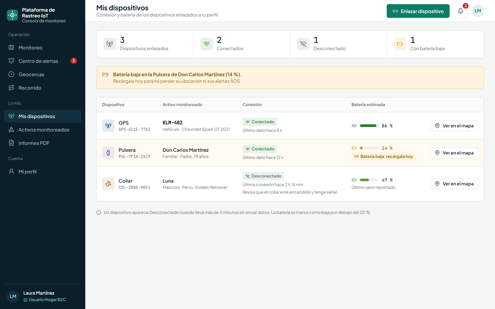

### HU-06: Estado de conexión y batería del dispositivo

**Como** usuario autenticado
**Quiero** ver el estado de conexión del dispositivo IoT y su nivel estimado de batería
**Para** conocer si el dispositivo está operativo y si requiere atención

**Validación INVEST**
- I — Independent: ✅ Puede desarrollarse por separado como una vista de estado de dispositivo.
- N — Negotiable: ✅ El detalle de cómo se calcula la batería y conexión puede ajustarse, pero la necesidad es clara.
- V — Valuable: ✅ Aporta valor porque permite detectar fallas operativas antes de que afecten el monitoreo.
- E — Estimable: ✅ Tiene un alcance claro y resultados observables.
- S — Small: ✅ Es una vista específica y acotada de telemetría.
- T — Testable: ✅ Se puede verificar con estados conectados, desconectados y batería baja.

**Gherkin**
```gherkin
# language: es
Característica: Estado de conexión y batería del dispositivo

  Escenario: Visualización de estado operativo
    Dado que un dispositivo está conectado y transmitiendo datos
    Cuando el usuario consulta el estado del dispositivo
    Entonces el sistema muestra que está conectado
    Y visualiza el nivel estimado de batería

  Escenario: Visualización de estado desconectado
    Dado que un dispositivo no reporta señal ni datos durante un periodo relevante
    Cuando el usuario consulta el estado del dispositivo
    Entonces el sistema muestra que está desconectado
    Y indica la falta de conexión claramente

  Escenario: Batería baja
    Dado que un dispositivo alcanza un nivel crítico de batería
    Cuando el usuario consulta el estado del dispositivo
    Entonces el sistema muestra una advertencia de batería baja
    Y sugiere revisión o recarga según el contexto
```

**Supuestos / preguntas abiertas**
- Se asume que el sistema obtiene datos de conexión y batería en tiempo real o con actualización periódica.
- Se asume que el nivel estimado de batería puede representarse con indicadores visuales o porcentajes.
- No quedan preguntas abiertas bloqueantes tras la clarificación recibida.

## Mockups


*Figura: Estado de conexión y batería de cada dispositivo: Conectado, Desconectado con su última conexión y advertencia de batería baja.*
