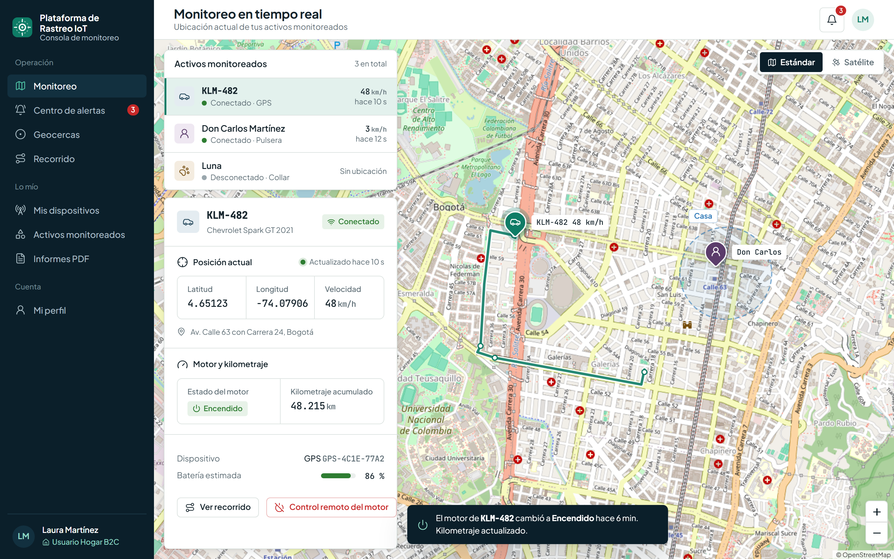
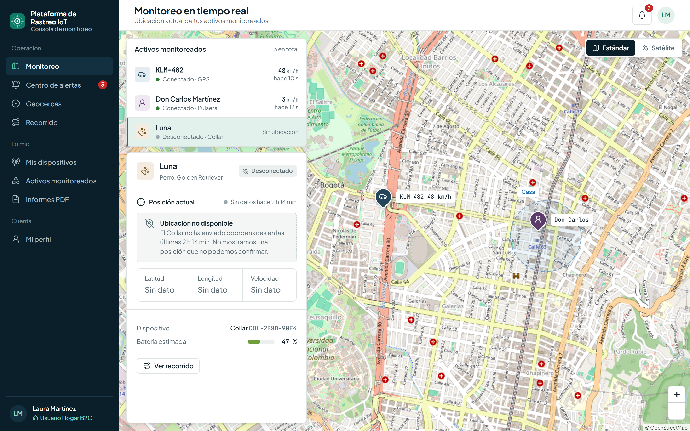

### HU-07: Posición en tiempo real y velocidad

**Como** usuario autenticado
**Quiero** ver la posición actual en tiempo real, la latitud, longitud y velocidad del dispositivo seleccionado
**Para** supervisar el movimiento del activo o sujeto monitorizado en tiempo real

**Validación INVEST**
- I — Independent: ✅ Puede desarrollarse como una funcionalidad independiente del resto del mapa.
- N — Negotiable: ✅ La forma de representar la ubicación puede variar, pero la necesidad del usuario es clara.
- V — Valuable: ✅ Aporta valor porque permite vigilancia en tiempo real del movimiento.
- E — Estimable: ✅ La funcionalidad tiene datos bien definidos y una salida visual clara.
- S — Small: ✅ Es una historia centrada en una vista de seguimiento en tiempo real.
- T — Testable: ✅ Puede verificarse con ubicación válida, velocidad reportada y ausencia de datos.

**Gherkin**
```gherkin
# language: es
Característica: Posición en tiempo real y velocidad

  Escenario: Visualización de ubicación actual
    Dado que un dispositivo está conectado y transmite su ubicación
    Cuando el usuario selecciona el dispositivo en el mapa
    Entonces el sistema muestra la posición actual en tiempo real
    Y presenta latitud, longitud y velocidad

  Escenario: Dispositivo sin ubicación actual
    Dado que un dispositivo no tiene datos de ubicación disponibles
    Cuando el usuario intenta consultarlo
    Entonces el sistema informa que la ubicación no está disponible
    Y evita mostrar coordenadas inexistentes

  Escenario: Cambio de posición del dispositivo
    Dado que el dispositivo se mueve
    Cuando el sistema recibe nuevas coordenadas
    Entonces actualiza la posición en el mapa
    Y refleja la velocidad reportada
```

**Supuestos / preguntas abiertas**
- Se asume que la ubicación se actualiza periódicamente con datos del dispositivo.
- Se asume que el mapa interactivo permite seleccionar un dispositivo y mostrar sus datos asociados.
- No quedan preguntas abiertas bloqueantes tras la clarificación recibida.

## Mockups


*Figura: KLM-482 seleccionado en el mapa con latitud, longitud, velocidad, "actualizado hace 10 s" y su trayecto reciente.*


*Figura: El Collar de Luna no tiene datos de ubicación: el sistema lo informa y no muestra coordenadas inexistentes.*
