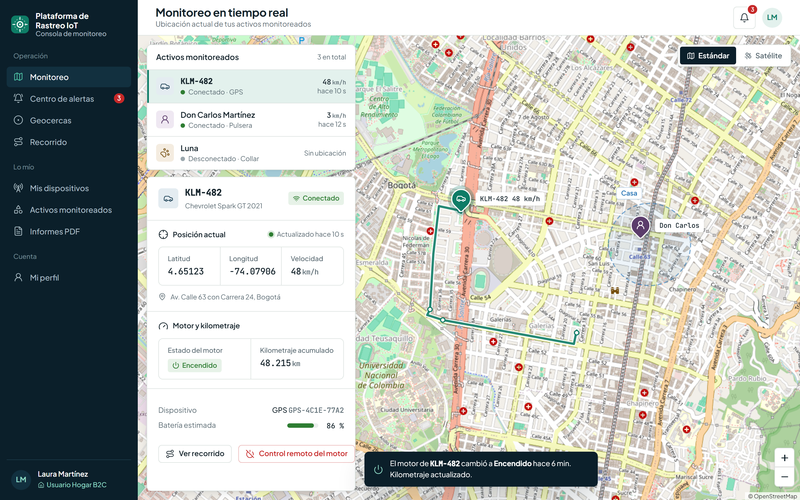
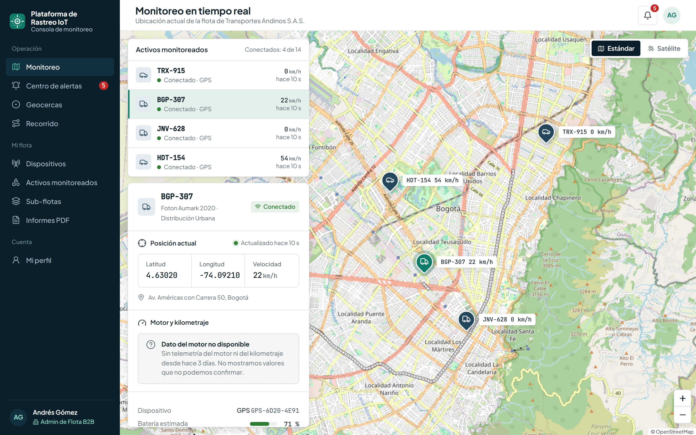

### HU-08: Estado del motor y kilometraje

**Como** usuario autenticado
**Quiero** ver el estado actual del motor del vehículo y el kilometraje acumulado
**Para** conocer el funcionamiento del vehículo y su uso histórico

**Validación INVEST**
- I — Independent: ✅ Puede desarrollarse como un módulo independiente de monitoreo del vehículo.
- N — Negotiable: ✅ El detalle de cómo se calcula el kilometraje puede ajustarse, pero el valor de negocio es claro.
- V — Valuable: ✅ Aporta valor porque ayuda a supervisar el estado operativo de un vehículo.
- E — Estimable: ✅ El alcance de los datos es claro y medible.
- S — Small: ✅ Es una vista específica de estado del vehículo.
- T — Testable: ✅ Puede verificarse con estados encendido/apagado y valores de kilometraje válidos.

**Gherkin**
```gherkin
# language: es
Característica: Estado del motor y kilometraje

  Escenario: Visualización del estado del motor
    Dado que un vehículo está asociado a un dispositivo
    Cuando el usuario consulta el estado del vehículo
    Entonces el sistema muestra si el motor está encendido o apagado
    Y presenta el kilometraje acumulado

  Escenario: Cambio de estado del motor
    Dado que el vehículo cambia su estado operativo
    Cuando el sistema recibe un nuevo dato de telemetría
    Entonces actualiza el estado del motor en la interfaz
    Y recalcula o muestra el kilometraje acumulado

  Escenario: Datos incompletos del vehículo
    Dado que un vehículo no tiene telemetría disponible
    Cuando el usuario consulta el estado
    Entonces el sistema informa que el dato no está disponible
    Y evita mostrar información incorrecta
```

**Supuestos / preguntas abiertas**
- Se asume que el sistema recibe telemetría del motor y kilometraje desde el dispositivo o fuente asociada.
- Se asume que los estados del motor se representan como encendido o apagado.
- No quedan preguntas abiertas bloqueantes tras la clarificación recibida.

## Mockups


*Figura: Motor Encendido y kilometraje acumulado de KLM-482, con el aviso del último cambio de estado del motor.*


*Figura: BGP-307 no tiene telemetría del motor: el sistema informa que el dato no está disponible.*
