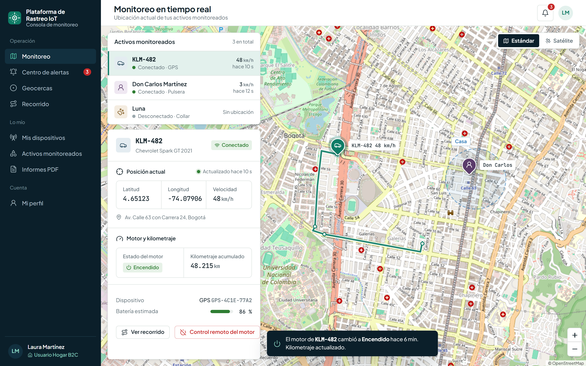
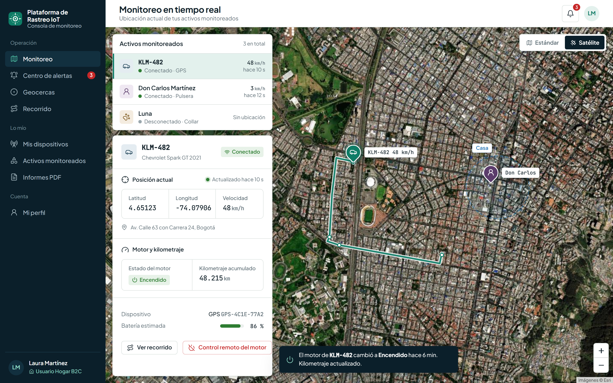
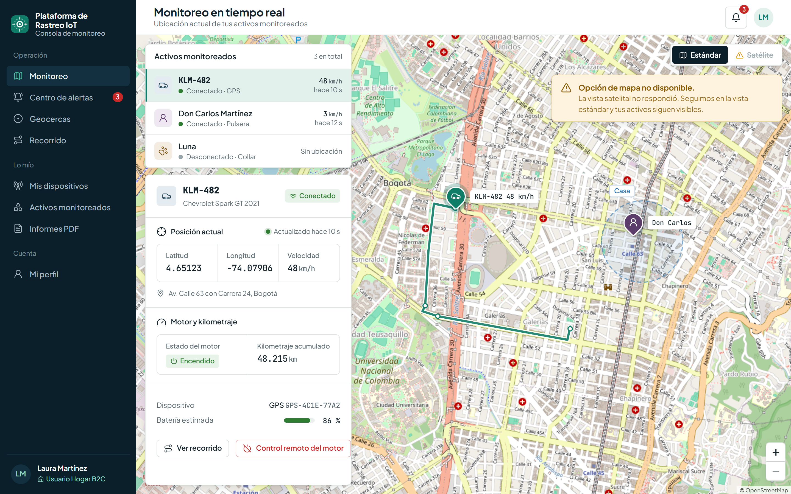

### HU-09: Cambio de vista del mapa

**Como** usuario autenticado
**Quiero** alternar la visualización del mapa entre vista vectorial estándar y mapa satelital
**Para** elegir la mejor perspectiva visual para monitorear los dispositivos

**Validación INVEST**
- I — Independent: ✅ Puede desarrollarse como una funcionalidad independiente de la capa base del mapa.
- N — Negotiable: ✅ La elección exacta de proveedor o estilo visual puede variar sin cambiar la necesidad del usuario.
- V — Valuable: ✅ Aporta valor porque mejora la legibilidad y contexto del mapa.
- E — Estimable: ✅ La interacción es simple y fácil de estimar.
- S — Small: ✅ Es una historia pequeña y enfocada en la alternancia de capas del mapa.
- T — Testable: ✅ Puede validarse con el cambio entre vista estándar y satelital.

**Gherkin**
```gherkin
# language: es
Característica: Cambio de vista del mapa

  Escenario: Cambio a vista vectorial estándar
    Dado que un usuario autenticado está en la vista del mapa
    Cuando selecciona la opción de mapa estándar
    Entonces el sistema muestra la vista vectorial estándar
    Y mantiene la ubicación de los dispositivos visibles

  Escenario: Cambio a vista satelital
    Dado que un usuario autenticado está en la vista del mapa
    Cuando selecciona la opción de mapa satelital
    Entonces el sistema cambia la capa del mapa a satelital
    Y mantiene el contexto geográfico de los dispositivos

  Escenario: Cambio de vista sin selección válida
    Dado que el usuario intenta activar una vista no disponible
    Cuando el sistema valida la opción
    Entonces no cambia la vista
    Y muestra un mensaje de opción no disponible
```

**Supuestos / preguntas abiertas**
- Se asume que el sistema tiene acceso a al menos dos capas de mapa: estándar y satelital.
- Se asume que la alternancia se realiza desde la misma vista de monitoreo.
- No quedan preguntas abiertas bloqueantes tras la clarificación recibida.

## Mockups


*Figura: Mapa en la vista vectorial estándar con los dispositivos visibles.*


*Figura: La capa cambia a satelital y se mantiene el contexto geográfico de los dispositivos.*


*Figura: La vista satelital no responde: el sistema no cambia la vista y muestra el mensaje de opción no disponible.*
