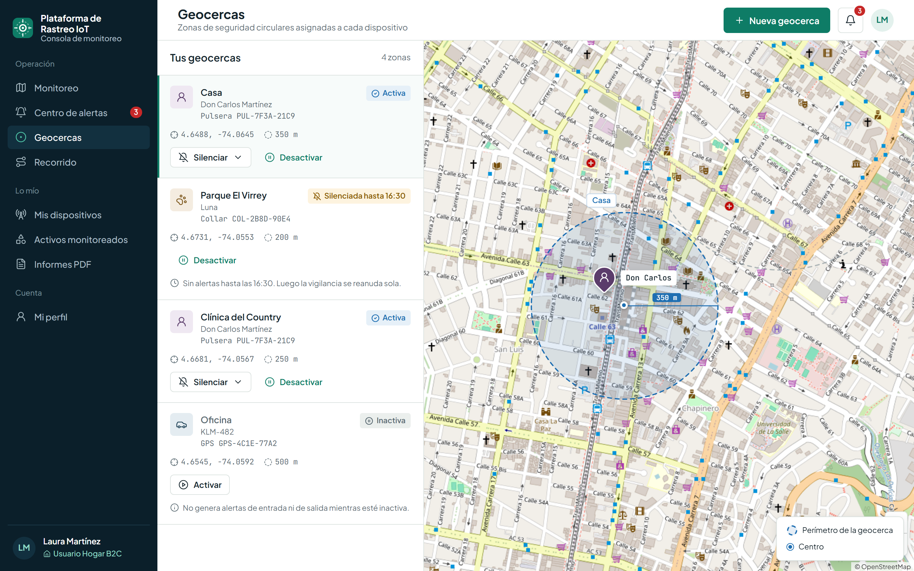
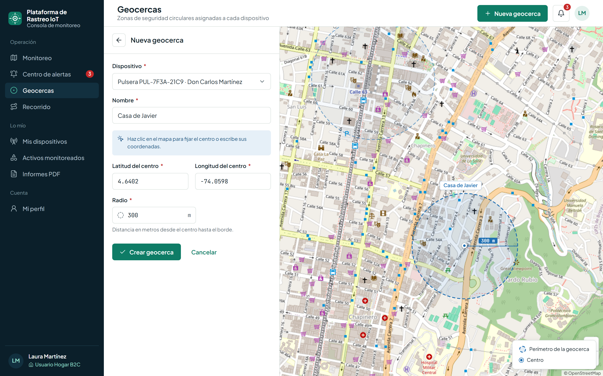
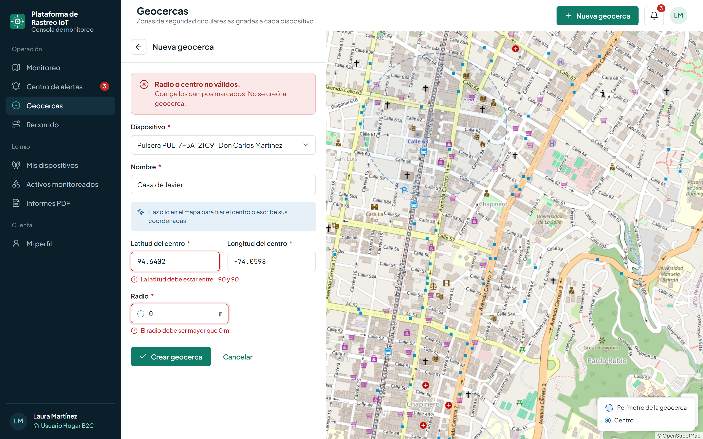

### HU-10: Definición de zonas de seguridad

**Como** usuario autenticado
**Quiero** definir en el mapa zonas de seguridad circulares con centro y radio para un dispositivo
**Para** establecer perímetros de vigilancia y control sobre ubicaciones relevantes

**Validación INVEST**
- I — Independent: ✅ Puede desarrollarse como una funcionalidad específica del mapa y del dispositivo.
- N — Negotiable: ✅ El modelo exacto de zona puede ajustarse, pero el valor del usuario es claro.
- V — Valuable: ✅ Aporta valor porque permite limitar rutas o áreas críticas bajo supervisión.
- E — Estimable: ✅ Tiene un alcance claro y datos suficientes para su estimación.
- S — Small: ✅ Es una historia acotada a la creación y administración de zonas de seguridad.
- T — Testable: ✅ Se puede verificar con zonas válidas, inválidas y activas.

**Gherkin**
```gherkin
# language: es
Característica: Definición de zonas de seguridad

  Escenario: Creación exitosa de una geocerca circular
    Dado que un usuario autenticado selecciona un dispositivo
    Cuando define una zona circular con centro y radio válidos
    Entonces el sistema crea la geocerca
    Y la muestra en el mapa asociado

  Escenario: Creación de geocerca con parámetros inválidos
    Dado que un usuario autenticado intenta definir una zona con radio o centro no válidos
    Cuando el sistema valida la información
    Entonces rechaza la creación
    Y muestra un mensaje de parámetros inválidos

  Escenario: Visualización de la geocerca en el mapa
    Dado que una geocerca ya fue creada
    Cuando el usuario consulta el mapa del dispositivo
    Entonces el sistema muestra el perímetro circular
    Y deja claro su centro y radio
```

**Supuestos / preguntas abiertas**
- Se asume que las geocercas son circulares con centro y radio definidos por coordenadas y distancia.
- Se asume que cada geocerca se asocia a un dispositivo específico.
- No quedan preguntas abiertas bloqueantes tras la clarificación recibida.

## Mockups


*Figura: Geocerca circular Casa dibujada en el mapa con su centro y su radio de 350 m.*


*Figura: Formulario para crear una geocerca: dispositivo, nombre, centro y radio, con la vista previa en el mapa.*


*Figura: El sistema rechaza la creación por parámetros inválidos y no dibuja ninguna zona.*
