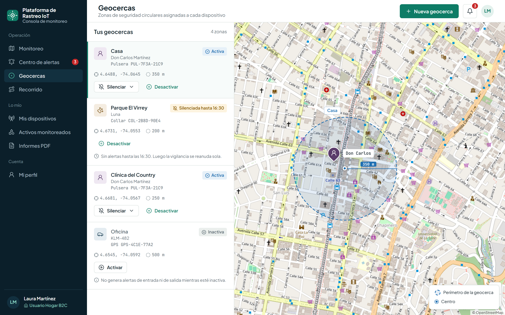
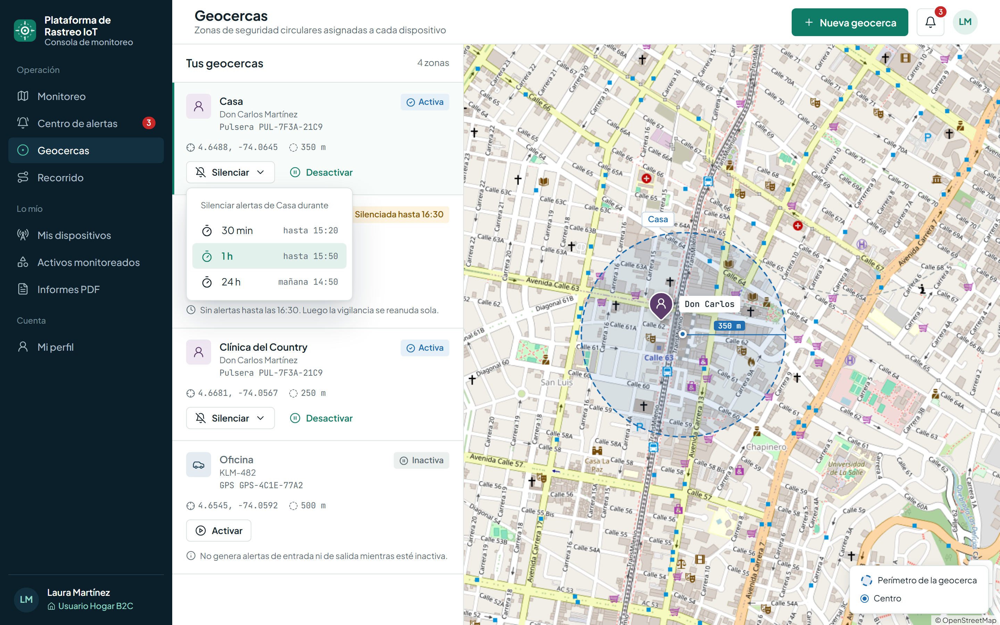

### HU-11: Activación, desactivación y silencio temporal de geocercas

**Como** usuario autenticado
**Quiero** activar, desactivar o silenciar temporalmente el control de geocercas para un dispositivo
**Para** adaptar la vigilancia geográfica según el momento o la necesidad del caso

**Validación INVEST**
- I — Independent: ✅ Puede desarrollarse como una funcionalidad de configuración del dispositivo.
- N — Negotiable: ✅ El detalle del silencio temporal puede ajustarse, pero la intención es clara.
- V — Valuable: ✅ Aporta valor porque permite control operativo de alertas geográficas.
- E — Estimable: ✅ Tiene un alcance claro y un comportamiento concreto.
- S — Small: ✅ Es una historia de configuración de alerta por geocerca.
- T — Testable: ✅ Puede verificarse con estados activo, inactivo y silenciado.

**Gherkin**
```gherkin
# language: es
Característica: Activación, desactivación y silencio temporal de geocercas

  Escenario: Activación de una geocerca
    Dado que un usuario autenticado tiene una geocerca creada
    Cuando activa la geocerca para un dispositivo
    Entonces el sistema la pone en estado activo
    Y comienza a evaluar entradas y salidas de la zona

  Escenario: Desactivación de una geocerca
    Dado que una geocerca está activa
    Cuando el usuario la desactiva
    Entonces el sistema la deja inactiva
    Y no genera alertas por esa geocerca mientras esté desactivada

  Escenario: Silencio temporal de una geocerca
    Dado que una geocerca activa está generando alertas
    Cuando el usuario la silencia temporalmente
    Entonces el sistema deja de emitir alertas por ese periodo
    Y reanuda la vigilancia al terminar el silencio
```

**Supuestos / preguntas abiertas**
- Se asume que el usuario puede cambiar el estado de una geocerca en cualquier momento.
- Se asume que el silencio temporal se define con duración configurable.
- No quedan preguntas abiertas bloqueantes tras la clarificación recibida.

## Mockups


*Figura: Geocercas Activa, Silenciada e Inactiva con sus acciones; la Inactiva no genera alertas.*


*Figura: Menú para silenciar la geocerca Casa durante 30 min, 1 h o 24 h.*
