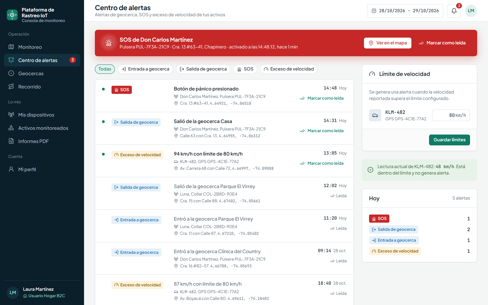
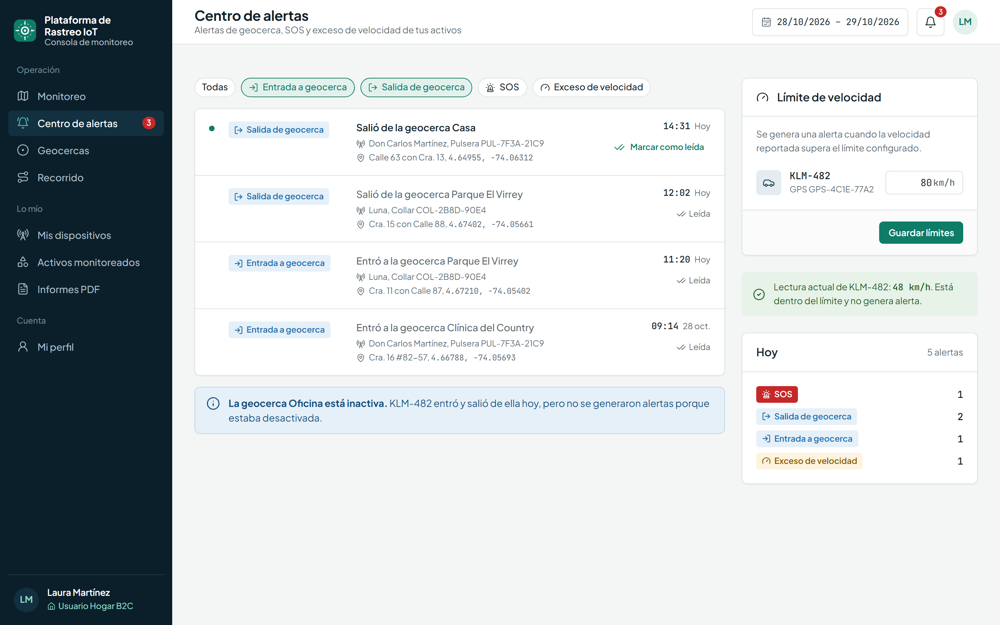

### HU-12: Generación de alertas por geocerca

**Como** usuario autenticado
**Quiero** recibir una alerta cuando un dispositivo entra o sale de una geocerca activa
**Para** conocer cambios importantes en el perímetro de seguridad y reaccionar oportunamente

**Validación INVEST**
- I — Independent: ✅ Puede desarrollarse junto con la configuración de geocercas y la base de alertas.
- N — Negotiable: ✅ La forma exacta de notificación puede variar según el canal disponible.
- V — Valuable: ✅ Aporta valor porque permite detectar eventos críticos de ubicación.
- E — Estimable: ✅ Tiene un flujo claro de activación, detección y registro.
- S — Small: ✅ Es una historia específica del evento geocerca.
- T — Testable: ✅ Puede validarse con eventos de entrada, salida y geocerca inactiva.

**Gherkin**
```gherkin
# language: es
Característica: Generación de alertas por geocerca

  Escenario: Alerta al entrar a una geocerca activa
    Dado que una geocerca está activa para un dispositivo
    Cuando el dispositivo entra en la zona delimitada
    Entonces el sistema genera una alerta de entrada
    Y registra el evento asociado

  Escenario: Alerta al salir de una geocerca activa
    Dado que una geocerca está activa para un dispositivo
    Cuando el dispositivo sale de la zona delimitada
    Entonces el sistema genera una alerta de salida
    Y registra el evento asociado

  Escenario: Geocerca inactiva no genera alertas
    Dado que una geocerca está desactivada
    Cuando el dispositivo entra o sale de la zona
    Entonces el sistema no genera alerta de geocerca
    Y no registra el evento como alerta activa
```

**Supuestos / preguntas abiertas**
- Se asume que el sistema registra cada evento de entrada/salida con timestamp y dispositivo asociado.
- Se asume que las alertas pueden visualizarse en pantalla y/o enviarse por notificación.
- No quedan preguntas abiertas bloqueantes tras la clarificación recibida.

## Mockups


*Figura: Alertas de entrada y salida de geocerca con dispositivo, hora y ubicación, filtros por tipo y fecha, y la acción "Marcar como leída".*


*Figura: Filtro por entrada y salida de geocerca, con el aviso de que la geocerca inactiva no generó alertas.*
