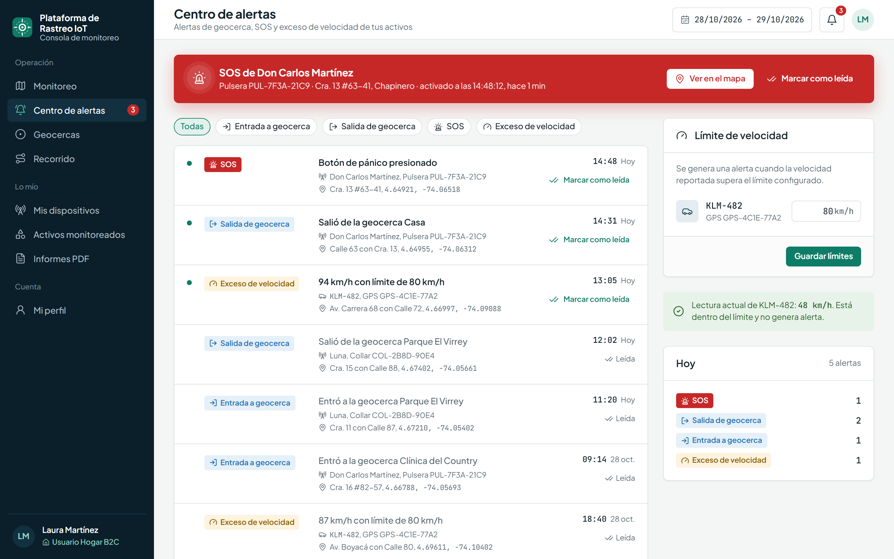
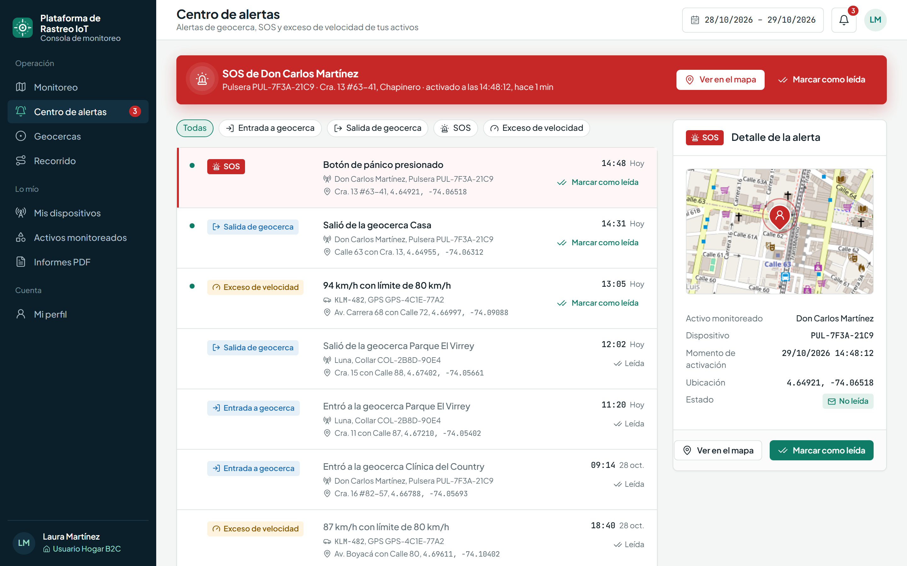
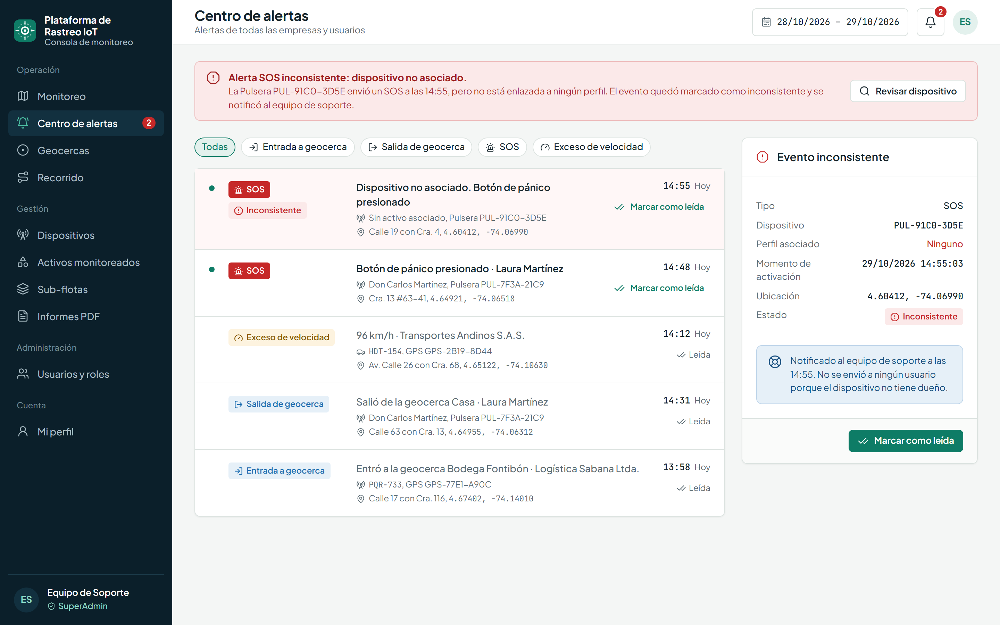

### HU-13: Señal de auxilio SOS

**Como** usuario autenticado
**Quiero** registrar y ver la señal de auxilio transmitida al presionar el botón de pánico SOS de un dispositivo
**Para** atender emergencias y tener evidencia del evento

**Validación INVEST**
- I — Independent: ✅ Puede desarrollarse como una historia específica de incidentes y alertas de emergencia.
- N — Negotiable: ✅ La forma exacta de reporte puede ajustarse, pero el valor es claro.
- V — Valuable: ✅ Aporta valor porque permite detectar emergencias y responder oportunamente.
- E — Estimable: ✅ Tiene un flujo concreto y datos bien definidos.
- S — Small: ✅ Es una historia centrada en el evento SOS.
- T — Testable: ✅ Puede verificarse con activación del botón SOS y visualización del evento.

**Gherkin**
```gherkin
# language: es
Característica: Señal de auxilio SOS

  Escenario: Activación del botón SOS
    Dado que un dispositivo tiene el botón de pánico disponible
    Cuando se presiona el botón SOS
    Entonces el sistema registra la señal de auxilio
    Y muestra el evento en pantalla para el usuario correspondiente

  Escenario: Visualización del evento SOS
    Dado que existe un evento de SOS registrado
    Cuando el usuario consulta el historial o el detalle del dispositivo
    Entonces el sistema muestra la señal de auxilio
    Y revela el momento de activación y estado asociado

  Escenario: SOS sin dispositivo asociado
    Dado que un evento SOS se registra para un dispositivo inexistente o no asociado
    Cuando el sistema valida el evento
    Entonces rechaza o marca el evento como inconsistente
    Y notifica el problema al equipo de soporte
```

**Supuestos / preguntas abiertas**
- Se asume que el botón de SOS transmite una señal que el sistema puede registrar.
- Se asume que los eventos SOS se muestran en una vista de alertas o historial.
- No quedan preguntas abiertas bloqueantes tras la clarificación recibida.

## Mockups


*Figura: Banner rojo con la señal SOS de Don Carlos Martínez, mostrada en pantalla al usuario.*


*Figura: Detalle de la alerta SOS con el momento de activación, la ubicación y su estado.*


*Figura: Vista del SuperAdmin: el SOS de un dispositivo no asociado se marca como inconsistente y se notifica al equipo de soporte.*
