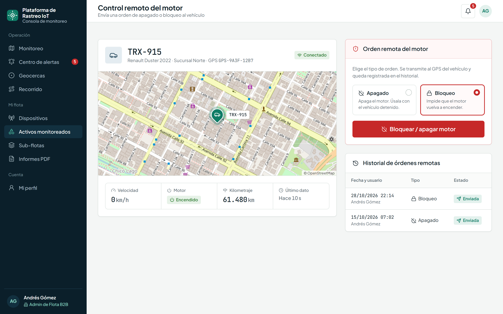
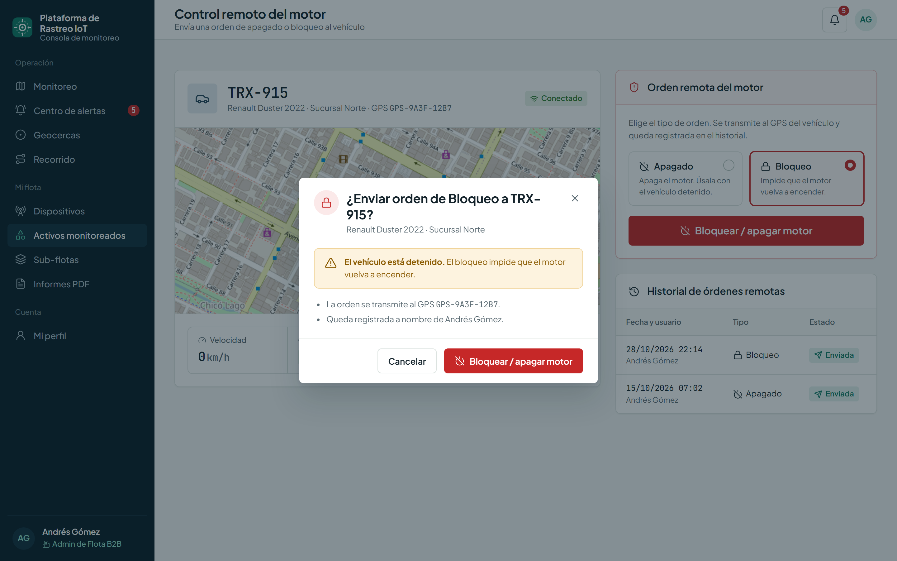
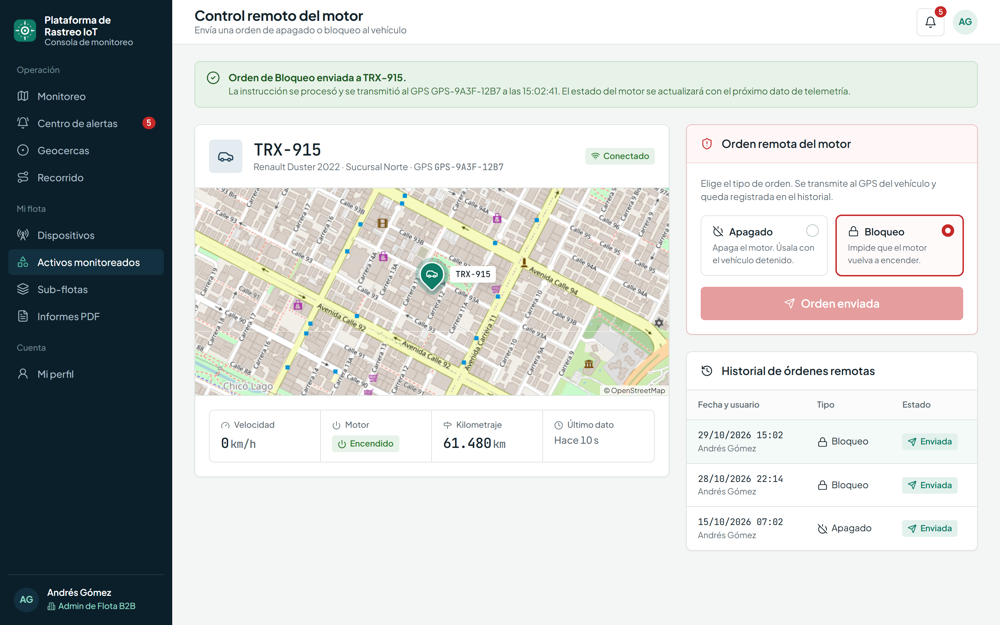
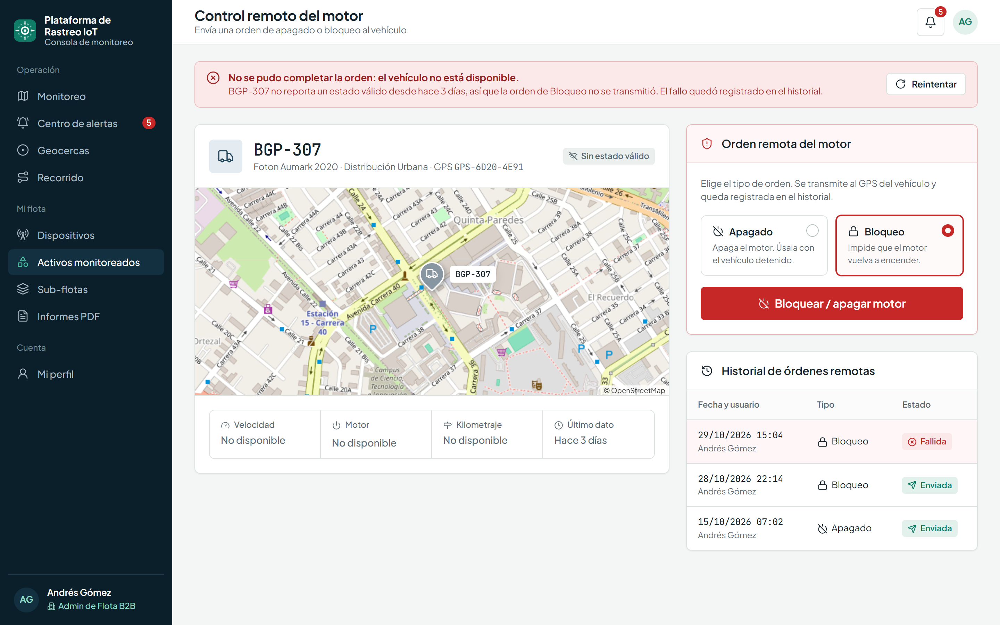
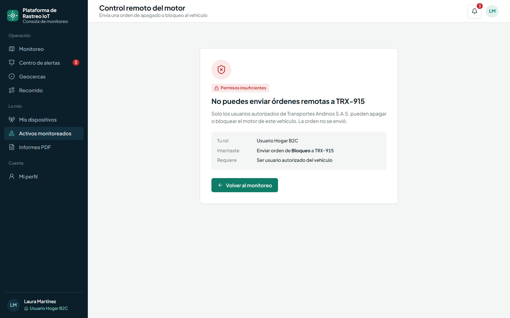

### HU-14: Apagado o bloqueo remoto del motor

**Como** usuario autorizado
**Quiero** enviar la orden de apagado o bloqueo remoto del motor hacia el vehículo
**Para** detener el vehículo de forma remota cuando sea necesario

**Validación INVEST**
- I — Independent: ✅ Puede desarrollarse como funcionalidad de control remoto del vehículo.
- N — Negotiable: ✅ El detalle de la acción remota puede ajustarse durante el diseño, pero la necesidad es clara.
- V — Valuable: ✅ Aporta valor porque permite actuar frente a riesgos, robos o situaciones de emergencia.
- E — Estimable: ✅ La acción tiene un flujo claro y permisos asociados.
- S — Small: ✅ Es una historia específica de control remoto del motor.
- T — Testable: ✅ Puede verificarse con envío exitoso de la orden y bloqueo por permisos.

**Gherkin**
```gherkin
# language: es
Característica: Apagado o bloqueo remoto del motor

  Escenario: Envío exitoso de orden de apagado remoto
    Dado que un usuario autorizado selecciona un vehículo
    Cuando envía la orden de apagado o bloqueo remoto
    Entonces el sistema procesa la instrucción
    Y la transmite al vehículo asociado

  Escenario: Usuario sin permisos intenta enviar la orden
    Dado que un usuario no está autorizado para controlar el vehículo
    Cuando intenta enviar la orden de apagado remoto
    Entonces el sistema rechaza la acción
    Y muestra un mensaje de permisos insuficientes

  Escenario: Vehículo no disponible para control remoto
    Dado que el vehículo no está accesible o no reporta estado válido
    Cuando el usuario intenta ejecutar la orden
    Entonces el sistema informa que la acción no puede completarse
    Y registra el fallo de envío
```

**Supuestos / preguntas abiertas**
- Se asume que la orden de apagado/bloqueo requiere permisos específicos según el rol y el vehículo.
- Se asume que la acción se ejecuta desde la aplicación web o móvil.
- No quedan preguntas abiertas bloqueantes tras la clarificación recibida.

## Mockups


*Figura: Detalle de TRX-915 con la orden remota (Apagado o Bloqueo) y el historial de órdenes.*


*Figura: Modal de confirmación antes de enviar la orden de Bloqueo.*


*Figura: La instrucción se procesa y se transmite al vehículo; queda registrada como Enviada.*


*Figura: El vehículo BGP-307 no está disponible: la orden no se completa y queda registrada como Fallida.*


*Figura: Un usuario no autorizado intenta enviar la orden y el sistema la rechaza.*
