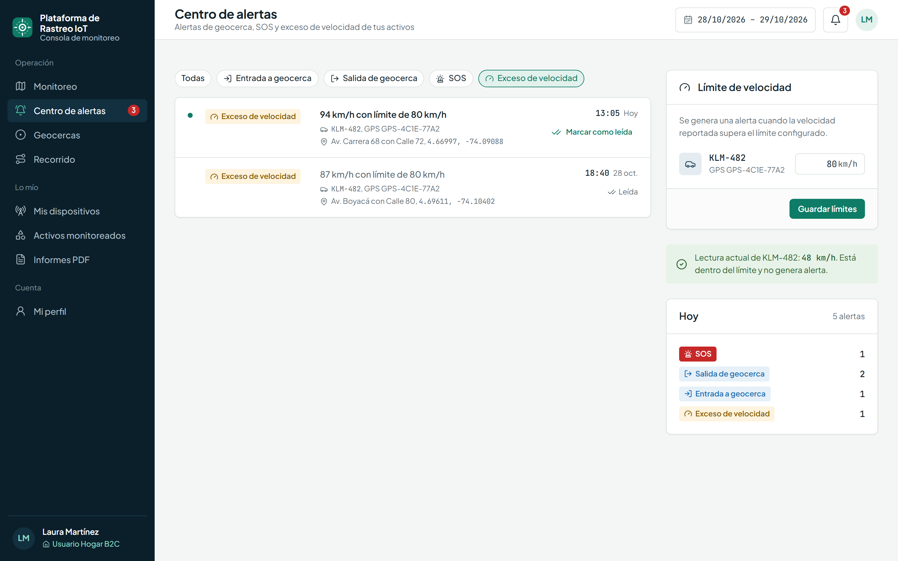
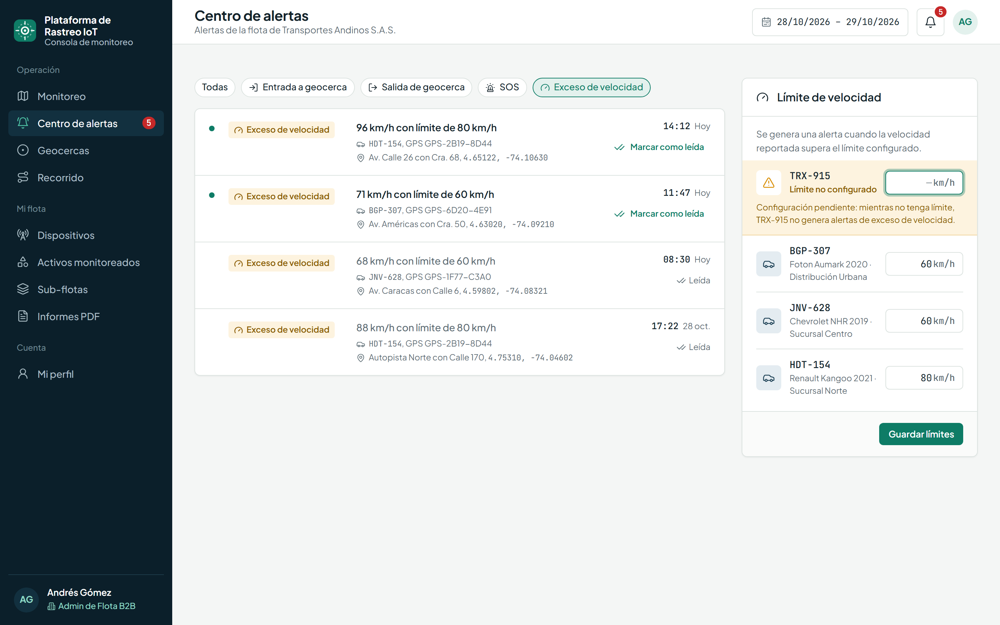

### HU-15: Alerta por exceso de velocidad

**Como** usuario autenticado
**Quiero** recibir una notificación cuando la velocidad reportada por un dispositivo excede el límite máximo configurado
**Para** reaccionar ante comportamientos de riesgo o incumplimientos de velocidad

**Validación INVEST**
- I — Independent: ✅ Puede desarrollarse como una funcionalidad de alertas basada en telemetría.
- N — Negotiable: ✅ El límite configurable puede variar por dispositivo o cliente, pero la funcionalidad es clara.
- V — Valuable: ✅ Aporta valor porque permite anticipar riesgos de seguridad.
- E — Estimable: ✅ Tiene un flujo claro: medición, comparación, generación de alerta.
- S — Small: ✅ Es una historia específica de alerta por velocidad.
- T — Testable: ✅ Puede validarse con velocidades dentro y fuera del límite configurado.

**Gherkin**
```gherkin
# language: es
Característica: Alerta por exceso de velocidad

  Escenario: Velocidad dentro del límite permitido
    Dado que un dispositivo reporta una velocidad que no supera el máximo configurado
    Cuando el sistema procesa la lectura
    Entonces no genera una alerta de exceso de velocidad
    Y conserva el estado normal del dispositivo

  Escenario: Velocidad por encima del límite configurado
    Dado que un dispositivo reporta una velocidad mayor al máximo configurado
    Cuando el sistema procesa la lectura
    Entonces genera una alerta de exceso de velocidad
    Y registra el evento con su timestamp

  Escenario: Límite máximo no configurado
    Dado que un dispositivo no tiene un límite máximo configurado
    Cuando el sistema intenta evaluar la velocidad
    Entonces no genera una alerta por exceso de velocidad
    Y muestra una indicación de configuración pendiente
```

**Supuestos / preguntas abiertas**
- Se asume que cada dispositivo o grupo puede tener un límite máximo configurado.
- Se asume que la alerta puede visualizarse como notificación en la aplicación y/o registro en historial.
- No quedan preguntas abiertas bloqueantes tras la clarificación recibida.

## Mockups


*Figura: Alertas de exceso de velocidad con su hora, el límite configurado de 80 km/h y una lectura dentro del límite sin alerta.*


*Figura: TRX-915 no tiene límite: no genera alertas y se muestra la indicación de configuración pendiente.*
