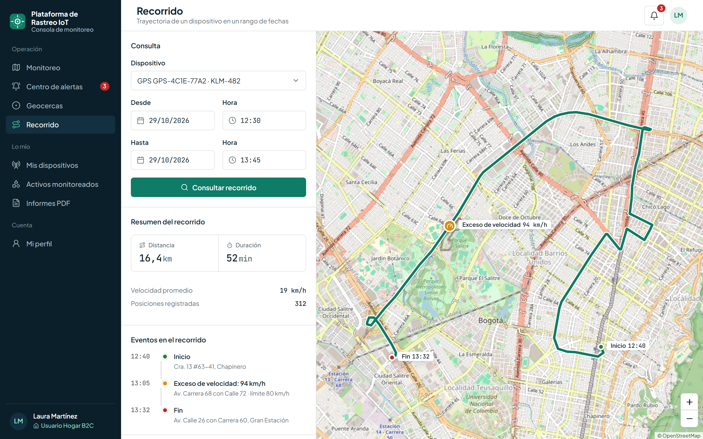
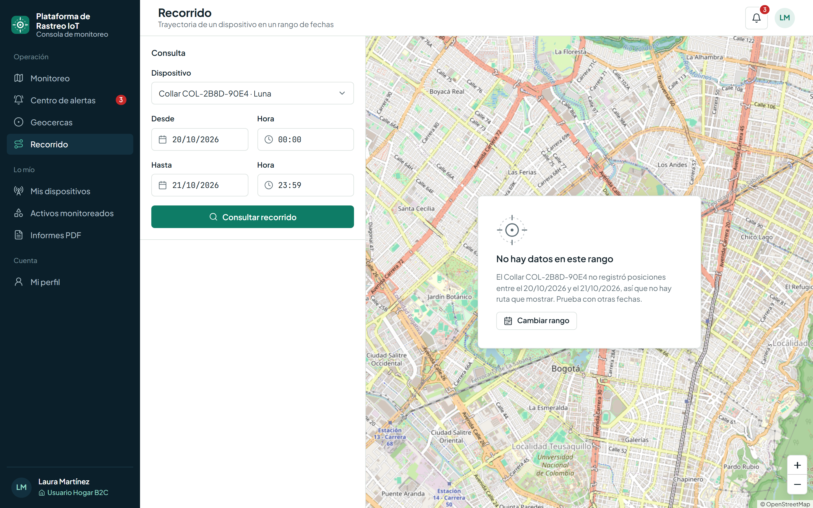
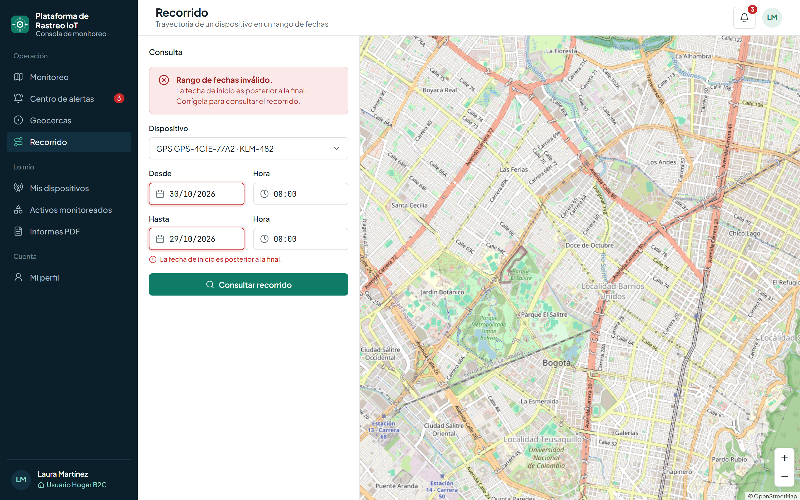

### HU-16: Consulta de recorrido y rango de fechas

**Como** usuario autenticado
**Quiero** consultar y representar sobre el mapa la trayectoria y recorrido realizado por un dispositivo dentro de un rango de fechas
**Para** analizar el historial de movimiento y eventos del dispositivo

**Validación INVEST**
- I — Independent: ✅ Puede desarrollarse como una historia de historial y trazado de recorrido.
- N — Negotiable: ✅ El formato de representación y los filtros pueden ajustarse, pero el valor es claro.
- V — Valuable: ✅ Aporta valor porque permite revisión posterior de rutas, viajes y ubicaciones.
- E — Estimable: ✅ Tiene un alcance claro de entrada, rango de fechas y representación en mapa.
- S — Small: ✅ Es una historia enfocada en una consulta de recorrido.
- T — Testable: ✅ Puede validarse con rangos válidos, vacíos y fechas inconsistentes.

**Gherkin**
```gherkin
# language: es
Característica: Consulta de recorrido y rango de fechas

  Escenario: Consulta exitosa de recorrido en un rango de fechas
    Dado que un usuario autenticado selecciona un dispositivo
    Cuando define un rango de fechas válido
    Entonces el sistema muestra la trayectoria en el mapa
    Y presenta el recorrido realizado en ese periodo

  Escenario: Rango de fechas sin datos
    Dado que no existen registros del dispositivo en el rango solicitado
    Cuando el usuario consulta el recorrido
    Entonces el sistema informa que no hay datos disponibles
    Y no representa una ruta vacía en el mapa

  Escenario: Rango de fechas inválido
    Dado que un usuario ingresa una fecha de inicio posterior a la fecha final
    Cuando intenta consultar el recorrido
    Entonces el sistema rechaza la consulta
    Y muestra un mensaje de rango inválido
```

**Supuestos / preguntas abiertas**
- Se asume que el sistema guarda históricos de ubicación y eventos por dispositivo.
- Se asume que la representación del recorrido se hace sobre un mapa interactivo.
- No quedan preguntas abiertas bloqueantes tras la clarificación recibida.

## Mockups


*Figura: Trayectoria de KLM-482 en el rango de fechas, con inicio, fin, distancia, duración y eventos.*


*Figura: El rango no tiene registros: el sistema lo informa y no dibuja una ruta vacía.*


*Figura: La fecha de inicio es posterior a la final y el sistema rechaza la consulta.*
