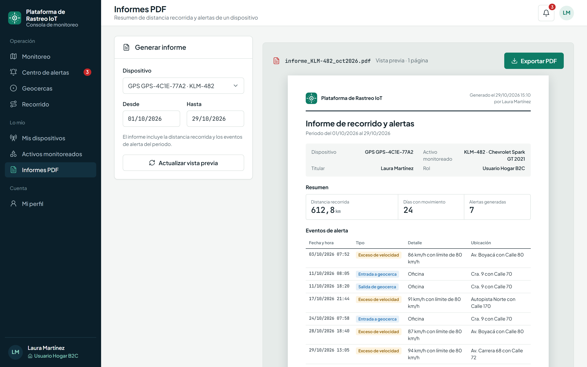
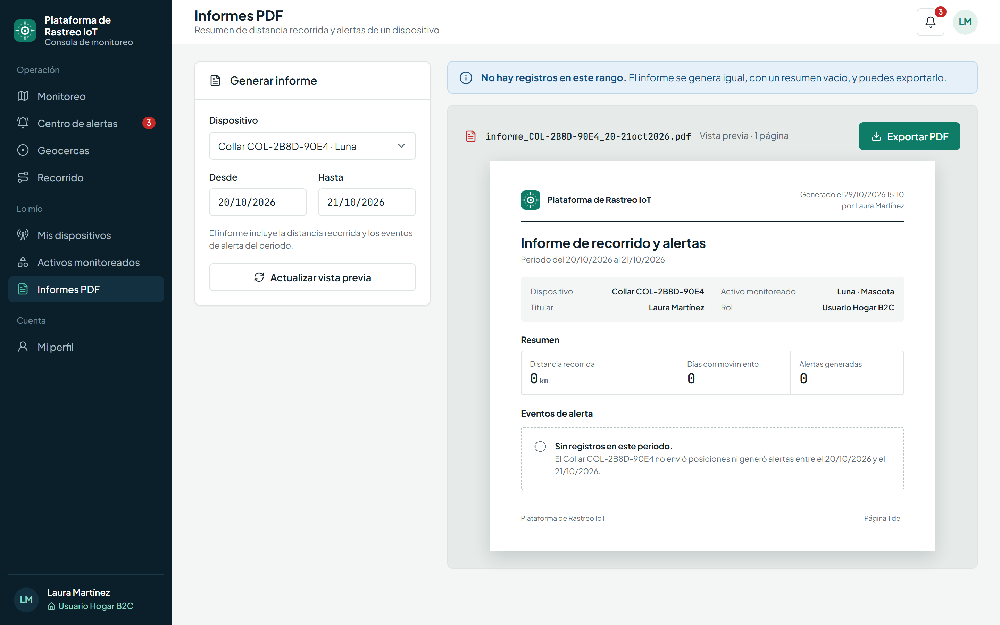
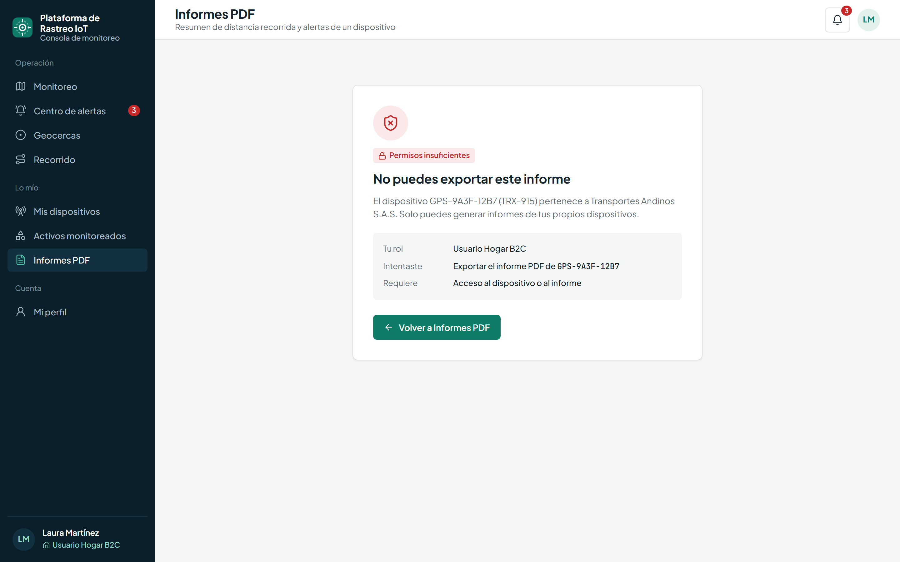

### HU-17: Exportación de informes PDF

**Como** usuario autenticado
**Quiero** exportar informes en formato PDF con el resumen de distancia recorrida y eventos de alerta generados
**Para** compartir y conservar un historial ejecutivo del rendimiento y eventos del dispositivo

**Validación INVEST**
- I — Independent: ✅ Puede desarrollarse como una historia separada de la consulta de recorrido.
- N — Negotiable: ✅ El contenido exacto del PDF puede ajustarse, pero la necesidad es clara.
- V — Valuable: ✅ Aporta valor porque permite entregar resúmenes descargables para clientes y gestión.
- E — Estimable: ✅ Tiene entradas claras y salida esperada bien definida.
- S — Small: ✅ Es una historia acotada a la exportación de informes.
- T — Testable: ✅ Puede validarse con generación exitosa y filtros de contenido vacíos.

**Gherkin**
```gherkin
# language: es
Característica: Exportación de informes PDF

  Escenario: Generación exitosa de un informe PDF
    Dado que un usuario autenticado selecciona un dispositivo y un rango de fechas
    Cuando solicita exportar el informe en PDF
    Entonces el sistema genera el archivo PDF
    Y incluye el resumen de distancia recorrida y eventos de alerta

  Escenario: Informe con datos vacíos
    Dado que el rango solicitado no tiene registros relevantes
    Cuando el usuario solicita exportar el documento
    Entonces el sistema genera un PDF con un resumen vacío o mensaje apropiado
    Y no falla la operación

  Escenario: Solicitud de exportación sin permisos
    Dado que un usuario no tiene acceso al dispositivo o al reporte
    Cuando intenta exportar el PDF
    Entonces el sistema rechaza la petición
    Y muestra un mensaje de permisos insuficientes
```

**Supuestos / preguntas abiertas**
- Se asume que el PDF incluye resúmenes de distancia recorrida y eventos de alerta relevantes.
- Se asume que la exportación puede hacerse desde el historial o los paneles de gestión.
- No quedan preguntas abiertas bloqueantes tras la clarificación recibida.

## Mockups


*Figura: Vista previa del informe con la distancia recorrida y la tabla de eventos de alerta, y el botón "Exportar PDF".*


*Figura: El rango no tiene registros: el PDF se genera con un resumen vacío y la operación no falla.*


*Figura: El usuario no tiene acceso al dispositivo y el sistema rechaza la exportación.*
