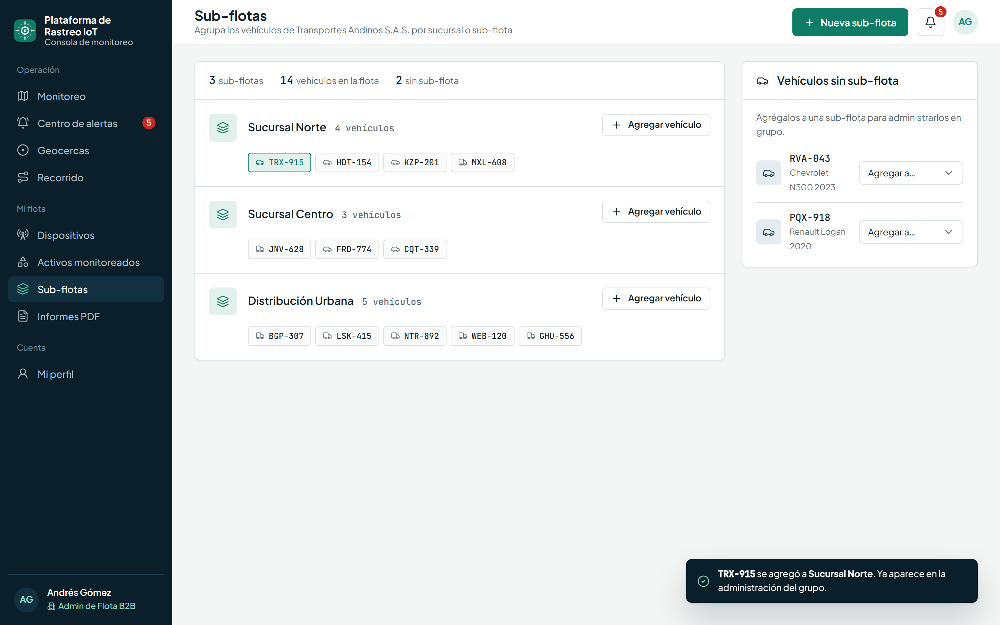
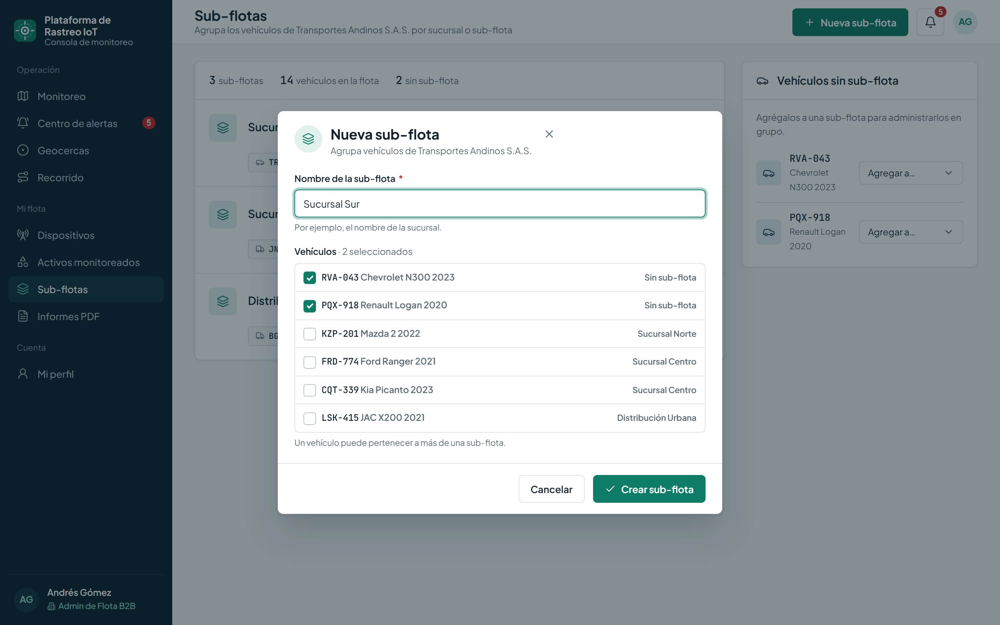
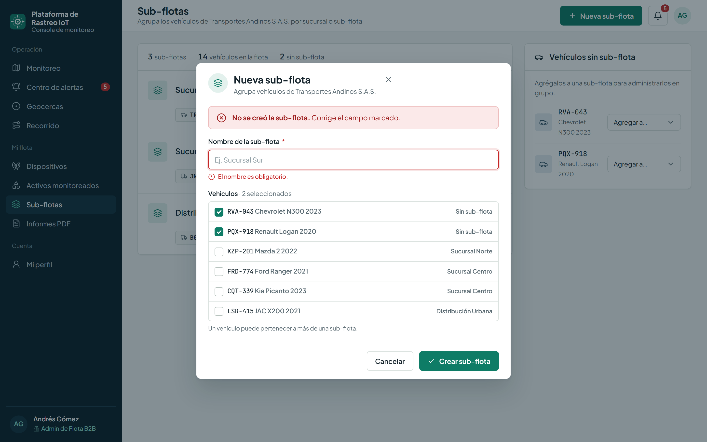

### HU-18: Agrupación de vehículos en sub-flotas o sucursales

**Como** cliente corporativo
**Quiero** agrupar mis vehículos en sub-flotas o sucursales
**Para** facilitar la administración masiva y la organización de mi operación

**Validación INVEST**
- I — Independent: ✅ Puede desarrollarse como un módulo de organización corporativa.
- N — Negotiable: ✅ La estructura exacta puede ajustarse entre etiquetas y permisos, pero el valor es claro.
- V — Valuable: ✅ Aporta valor porque simplifica la administración masiva para clientes corporativos.
- E — Estimable: ✅ Tiene un alcance claro y una relación directa con la organización de vehículos.
- S — Small: ✅ Es una historia enfocada en agrupaciones empresariales.
- T — Testable: ✅ Puede verificarse con agrupación exitosa, reasignación y validación de permisos.

**Gherkin**
```gherkin
# language: es
Característica: Agrupación de vehículos en sub-flotas o sucursales

  Escenario: Creación exitosa de una sub-flota o sucursal
    Dado que un cliente corporativo tiene vehículos asociados a su cuenta
    Cuando crea una sub-flota o sucursal
    Entonces el sistema guarda la agrupación
    Y permite asociar vehículos a ella

  Escenario: Asociación de un vehículo a una agrupación
    Dado que una sub-flota o sucursal ya existe
    Cuando un cliente corporativo agrega un vehículo a esa agrupación
    Entonces el sistema vincula el vehículo correctamente
    Y refleja la agrupación en la administración masiva

  Escenario: Agrupación con datos incompletos
    Dado que un cliente corporativo intenta crear una agrupación sin nombre o sin alcance válido
    Cuando el sistema valida la información
    Entonces rechaza la creación
    Y muestra un mensaje de validación correspondiente
```

**Supuestos / preguntas abiertas**
- Se asume que las sub-flotas o sucursales son agrupaciones de organización para clientes corporativos y no una estructura jerárquica con permisos independientes.
- Se asume que los vehículos pueden asociarse a una o varias agrupaciones según la necesidad de negocio.
- No quedan preguntas abiertas bloqueantes tras la clarificación recibida.

## Mockups


*Figura: Sub-flotas de Transportes Andinos S.A.S. con su número de vehículos y el aviso de un vehículo agregado a Sucursal Norte.*


*Figura: Modal para crear una sub-flota y asignarle vehículos.*


*Figura: El sistema rechaza la creación con el mensaje "El nombre es obligatorio".*
